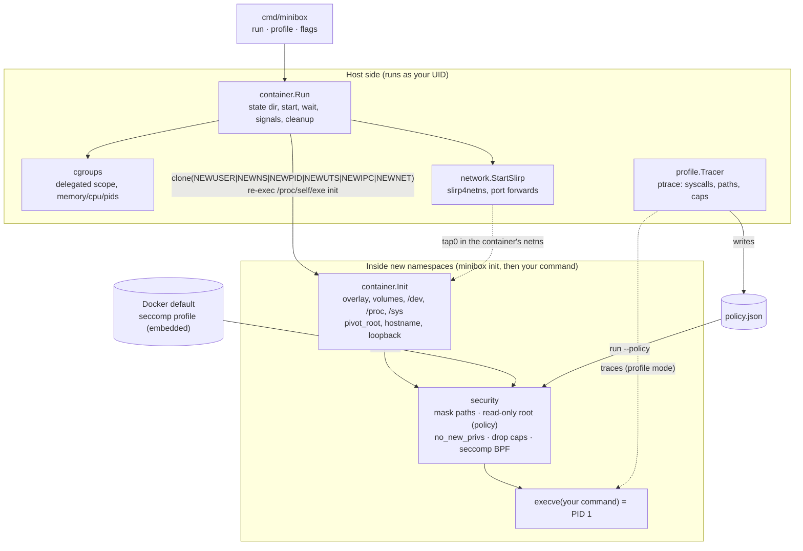

# minibox: Project Documentation

> A rootless Linux container runtime in Go, with automatic least-privilege
> hardening, built from scratch as an Operating Systems course project.

This is the single complete reference for the project: what it does, how
every feature works, how to use it, how it was tested and evaluated, and
what its limits are. Shorter, topic-specific documents are listed in
[§17](#17-document-index).

---

## Table of contents

1. [Overview](#1-overview)
2. [Requirements and environment](#2-requirements-and-environment)
3. [Installation and build](#3-installation-and-build)
4. [Architecture](#4-architecture)
5. [Life of a container, step by step](#5-life-of-a-container-step-by-step)
6. [Features in detail](#6-features-in-detail)
   - 6.1 Isolation (namespaces) · 6.2 Filesystem (overlayfs, pivot_root, /dev, /proc, /sys) ·
     6.3 Volumes · 6.4 Resource limits (cgroups v2) · 6.5 Networking ·
     6.6 Baseline security · 6.7 Profiling mode · 6.8 Policy enforcement
7. [Command-line reference](#7-command-line-reference)
8. [The policy file](#8-the-policy-file)
9. [Usage guide and walkthroughs](#9-usage-guide-and-walkthroughs)
10. [Testing](#10-testing)
11. [Evaluation and results](#11-evaluation-and-results)
12. [Repository layout and code map](#12-repository-layout-and-code-map)
13. [Scripts and Makefile targets](#13-scripts-and-makefile-targets)
14. [Key design decisions](#14-key-design-decisions)
15. [Limitations and known issues](#15-limitations-and-known-issues)
16. [Troubleshooting](#16-troubleshooting)
17. [Document index](#17-document-index)
18. [Glossary](#18-glossary)

---

## 1. Overview

### What it is

`minibox` runs a command inside an isolated, resource-limited and hardened
environment (a *container*) without needing root. On top of the usual
runtime features it adds a **profile → enforce** workflow:

1. `minibox profile` runs an application under a tracer and records what it
   actually does: which system calls it makes, which files it reads and
   writes, and which privileges it appears to need.
2. It writes this down as a **policy** (`policy.json`).
3. `minibox run --policy policy.json` runs the application again, allowing
   *only* what was recorded. Every other syscall fails, unneeded
   capabilities are gone, and the filesystem is read-only except where the
   app wrote.

### Goals

| Goal | Achieved by |
|------|-------------|
| Isolation | 6 Linux namespaces, overlayfs root, pivot_root |
| Resource control | cgroups v2: memory, CPU, process count |
| Networking | private network namespace; rootless outbound access and port publishing via slirp4netns |
| Docker-level default security | Docker's capability set and seccomp profile, masked paths, no_new_privs |
| Least privilege, automatically | ptrace profiler that generates per-app policies, plus an enforcer |
| Evidence | 17-attack suite under 3 configurations, overhead benchmarks, syscall-count comparison, all scripted |
| No root anywhere | user namespaces, delegated cgroups, user-mode networking, ptrace on own children |

### Feature summary

| Feature | Command / flag |
|---------|----------------|
| Run a command in a container | `minibox run <rootfs> <cmd> [args]` |
| Hostname | `--hostname` |
| Memory / CPU / process limits | `--memory`, `--cpus`, `--pids`, `--stats` |
| Network off (default) or on | `--net none\|bridge` |
| Publish ports | `-p HOST:CONTAINER[/udp]` |
| Bind-mount host directories | `-v HOST:CONTAINER[:ro]` |
| Hardening level | `--security baseline\|none` |
| Generate a policy | `minibox profile [-o file] [--merge] ...` |
| Enforce a policy | `--policy file` |

---

## 2. Requirements and environment

| Requirement | Why | Development VM |
|-------------|-----|----------------|
| Linux ≥ 5.11 | rootless overlayfs (5.11), `clone3`/`CLONE_INTO_CGROUP` (5.7), `PTRACE_GET_SYSCALL_INFO` (5.3), seccomp action cache (5.11) | Ubuntu Server 26.04.1, kernel 7.0.0-38-generic, VirtualBox, 4 vCPUs |
| cgroups v2, with `cpu memory pids` delegated to the user | resource limits | yes (systemd default) |
| Unprivileged user namespaces | rootless containers | `kernel.apparmor_restrict_unprivileged_userns=0` set by the user |
| overlayfs (module) | copy-on-write root | `CONFIG_OVERLAY_FS=m`, loads on first use |
| `systemd-run --user` | obtain a delegated cgroup | yes |
| Go 1.27+ | build | Go 1.27.3 linux/amd64 |
| x86_64 | syscall table, seccomp arch check | yes |
| Optional: `slirp4netns`, `/dev/net/tun` | `--net bridge` | slirp4netns 1.3.3 |
| Optional: `python3`, `curl` on the host | evaluation scripts, image download | yes |

Go dependencies: the standard library and `golang.org/x/sys/unix` only.
There is no cgo.

Check everything with:

```sh
make check-env        # = scripts/check-env.sh
```

It checks: not running as root, kernel version, Go, cgroup v2 and delegated
controllers, user namespace sysctls plus a real `unshare` test, a real
overlay mount inside a user namespace, subuid/newuidmap (optional),
slirp4netns and `/dev/net/tun` (optional), vCPU stalls in the kernel log
(which would invalidate CPU limits and benchmarks), and download tools.
Each problem comes with the exact fix.

---

## 3. Installation and build

```sh
git clone <repo> minibox && cd minibox
make check-env            # 1. verify the machine
make image                # 2. download Alpine minirootfs -> images/alpine (SHA-256 verified)
make build                # 3. build bin/minibox
make test                 # 4. unit tests
make smoke                # 5. end-to-end tests of every phase (needs images/alpine)
```

Optional, for the evaluation:

```sh
make bench-image          # images/bench = Alpine + python3 + busybox httpd
make attacks              # attack suite -> results/attacks.{csv,md}
make bench                # benchmarks   -> results/bench.{csv,md}, results/syscalls.{csv,md}
```

`images/` and `bin/` are git-ignored. An "image" in minibox is simply a
root filesystem directory.

---

## 4. Architecture



### Packages

| Package | Responsibility | Key OS concepts |
|---------|----------------|-----------------|
| `cmd/minibox` | CLI parsing, subcommand dispatch, systemd-run re-exec | — |
| `internal/container` | Config, starting the container, the init process, filesystem setup, cleanup | namespaces, overlayfs, pivot_root, procfs/sysfs, bind mounts |
| `internal/cgroups` | Create the cgroup, apply limits, read stats, destroy | cgroup v2, delegation, `CLONE_INTO_CGROUP` |
| `internal/network` | Modes, port parsing, loopback, slirp4netns wrapper | network namespaces, tap devices, user-mode TCP/IP |
| `internal/security` | Capabilities, seccomp compiler, Docker profile, masked paths, policy format and enforcement | capabilities, seccomp-BPF, no_new_privs, remounts |
| `internal/profile` | ptrace tracer, syscall/path/capability recorder, policy building and merging | ptrace, `/proc/<pid>/mem` |

### Two processes, two sides

minibox is written in Go, which can't run code between `fork()` and
`exec()`. So `minibox run` (the **parent**, on the host) starts a second
copy of itself, `minibox init`, that is already **inside** the new
namespaces. The parent handles host-side work: the cgroup, slirp4netns,
waiting, signals and cleanup. init handles container-side work: mounts,
pivot_root and security. It then `execve`s your command, so no minibox code
is left in the container.

---

## 5. Life of a container, step by step

```mermaid
sequenceDiagram
    participant P as minibox run (host)
    participant K as kernel
    participant S as slirp4netns
    participant I as minibox init (container)
    P->>P: parse flags, validate rootfs, random 12-hex ID
    P->>P: (limits?) re-exec under systemd-run --user --scope -p Delegate=yes
    P->>P: create state dir upper/ work/ merged/
    P->>K: (limits?) mkdir cgroup, write memory.max / cpu.max / pids.max
    P->>K: clone3(NEWUSER|NEWNS|NEWPID|NEWUTS|NEWIPC|NEWNET, INTO_CGROUP) exec /proc/self/exe init
    P->>K: uid_map "0 <uid> 1", setgroups deny, gid_map
    Note over I: blocks reading its config pipe
    P->>S: (bridge) slirp4netns attaches to init's netns, creates tap0
    S-->>P: ready; P adds port forwards via API socket
    P->>I: config JSON over fd 3 (this releases init)
    I->>K: make / private, mount overlay, resolv.conf, volumes
    I->>K: tmpfs /dev + bind null/zero/full/random/urandom/tty
    I->>K: mount /proc, mount /sys (ro), before pivot_root
    I->>K: pivot_root, detach old root, sethostname, lo up
    I->>K: mask /proc & /sys paths; (policy) remount / read-only
    I->>K: no_new_privs, drop capabilities, install seccomp filter
    I->>K: execve(command), which is now PID 1
    Note over P: forwards Ctrl-C etc.; waits
    I-->>P: exit status
    P->>K: read cgroup stats, cgroup.kill, rmdir cgroup
    P->>S: close exit-fd, slirp4netns exits
    P->>P: remove state dir; exit with the command's status
```

Mounts are never unmounted by hand. They live only in the container's
mount namespace, which the kernel destroys when the last process exits, and
the PID namespace guarantees that all processes die when PID 1 exits.

---

## 6. Features in detail

### 6.1 Isolation: namespaces

Created with a single `clone()` (`internal/container/run.go`):

| Namespace | Effect inside the container |
|-----------|-----------------------------|
| **User** | You are UID 0 ("root"), mapped to your real UID on the host (`/proc/self/uid_map` = `0 1000 1`). Capabilities only apply to objects this namespace owns. This is what makes minibox rootless. |
| **Mount** | A private mount table: overlay root, `/dev`, `/proc`, `/sys`. Invisible to the host. |
| **PID** | Your command is PID 1; host processes are invisible. |
| **UTS** | Own hostname (`--hostname`, default = container ID). |
| **IPC** | Own System V IPC and POSIX message queues. |
| **Network** | Own interfaces, routes and ports (see 6.5). |

Details worth knowing:
- **Single-ID mapping.** Only container root is mapped. That's the only
  kind of map an unprivileged process may write. `setgroups` is set to
  `deny`, which the kernel requires before an unprivileged `gid_map`.
- **Clean environment.** The command gets `PATH`, `HOME=/root`, `HOSTNAME`
  and `TERM` only. The host environment doesn't leak in.
- **Config over a pipe** (fd 3), not argv or the environment, so nothing
  about it shows in `/proc/1/cmdline` or `/proc/1/environ`.
- **PID 1 semantics.** The kernel ignores signals sent to a namespace's PID 1
  unless it handles them, so `sleep 100` ignores Ctrl-C (just like
  `docker run` without `--init`). minibox forwards the first
  SIGINT/SIGTERM/SIGHUP/SIGQUIT and sends **SIGKILL on the second**. PID 1
  must reap its own zombies.
- **Orphan protection.** `Pdeathsig=SIGKILL` kills the container if minibox dies.

### 6.2 Filesystem

| Piece | What happens | Why |
|-------|--------------|-----|
| **overlayfs root** | lower = image (read-only), upper/work = `~/.local/share/minibox/containers/<id>/` | The image is never modified; containers share it; writes are discarded on exit |
| **`/dev`** | fresh tmpfs + bind mounts of host `null zero full random urandom tty`, plus `fd`/`stdin`/`stdout`/`stderr` symlinks | `mknod` is impossible rootless, and only harmless devices are exposed |
| **`/proc`** | fresh procfs (only container processes) | Must be mounted **before** pivot_root (kernel rule `mnt_already_visible`) |
| **`/sys`** | fresh sysfs, **read-only** | Needs our own network namespace; read-only so nothing reconfigures kernel objects |
| **pivot_root** | swap the root mount, then lazily unmount the old root | Unlike `chroot`, the host filesystem is really gone and can't be escaped |
| **`/etc/resolv.conf`** | `nameserver 10.0.3.3` written through the overlay (bridge mode only) | The host's `127.0.0.53` is unreachable from the container |

State directories live on disk (not `/run/user`, which is RAM), and
`MINIBOX_ROOT` overrides the location. They're deleted on exit, including
overlay's mode-000 `work/work`.

### 6.3 Volumes (`-v`)

`-v HOST:CONTAINER[:ro]` bind-mounts an existing host directory into the
container before pivot_root. `:ro` remounts the bind read-only. You can
only mount what your own user can already access. Volumes are separate
mounts, so in policy mode they stay writable unless `:ro`.

```sh
minibox run -v "$PWD/data:/data:ro" images/alpine ls /data
```

### 6.4 Resource limits: cgroups v2

| Flag | cgroup file | Effect |
|------|-------------|--------|
| `--memory 64m` | `memory.max`, `memory.swap.max=0` | Over the limit means the OOM killer stops the process (exit 137). Swap is off so it can't escape into swap. |
| `--cpus 0.5` | `cpu.max = 50000 100000` | At most 50 ms of CPU per 100 ms; the task is throttled |
| `--pids 50` | `pids.max` | `fork`/`clone` fail beyond it (counts **threads** too; minimum 8 because the Go init itself uses a few threads) |
| `--stats` | `cpu.stat`, `memory.peak`, `memory.events`, `pids.peak`, `pids.events` | Usage printed to stderr on exit |

How the rootless part works:
1. A login shell's cgroup belongs to root, so minibox re-executes itself as
   `systemd-run --user --scope -p Delegate=yes -- minibox run ...`, which
   gives it a cgroup it owns.
2. It moves itself into a `supervisor` leaf (cgroup v2's "no internal
   processes" rule) and enables `+cpu +memory +pids`.
3. It creates the container cgroup, writes the limits, and starts init
   **directly inside it** with `clone3(CLONE_INTO_CGROUP)`, so there's no
   window in which the container runs unlimited.
4. After exit: read stats, write `cgroup.kill`, `rmdir`. systemd removes the scope.

minibox always reports OOM kills and refused forks, even without `--stats`.

### 6.5 Networking

| Mode | What the container gets |
|------|-------------------------|
| `--net none` *(default)* | Its own network namespace with only `lo` (brought UP via `SIOCSIFFLAGS` ioctl). No route out. |
| `--net bridge` | Additionally `tap0` = **10.0.3.100/24**, gateway 10.0.3.2, DNS 10.0.3.3, outbound NAT, and published ports via `-p`. |

**Why slirp4netns and not veth + bridge + iptables?** The classic Docker
setup creates a veth pair, attaches the host end to a bridge, enables
`ip_forward` and adds an iptables MASQUERADE rule. Every one of those
host-side steps changes the **host's** network namespace and needs real
root. slirp4netns is a user-space TCP/IP stack (the one rootless Podman and
Docker use). It joins the container's namespaces, creates `tap0`, and
turns each packet into ordinary socket calls on the host. The tradeoffs are
lower throughput, no container-to-container traffic, and outbound traffic
always appearing to come from the host's IP.

How minibox runs it:
- `--configure --mtu=65520 --cidr=10.0.3.0/24`. 10.0.3.x is used because
  VirtualBox NAT already uses 10.0.2.x for the VM itself.
- `--disable-host-loopback`: the container can't reach services on the
  VM's `127.0.0.1`.
- `--enable-sandbox --enable-seccomp`: slirp4netns confines itself, since it
  parses untrusted packets.
- **No race:** init blocks on its config pipe until slirp4netns reports
  ready and the port forwards are installed.
- **Cleanup that survives `kill -9`:** slirp4netns gets an `--exit-fd`
  pipe. When minibox exits or dies, the pipe closes and slirp4netns exits.
- `-p 8080:80` asks slirp4netns over its API socket (`add_hostfwd`) to
  listen on host `0.0.0.0:8080`. Host ports must be ≥ 1024. A busy port is a
  clear error.

### 6.6 Baseline security (`--security baseline`, the default)

| Mechanism | Setting |
|-----------|---------|
| **Capabilities** | Keep Docker's 14 defaults: CHOWN, DAC_OVERRIDE, FSETID, FOWNER, MKNOD, NET_RAW, SETGID, SETUID, SETFCAP, SETPCAP, NET_BIND_SERVICE, SYS_CHROOT, KILL, AUDIT_WRITE (mask `0xa80425fb`). Drop all others from the **bounding**, effective, permitted and inheritable sets; clear the ambient set. |
| **seccomp** | Docker's default profile (moby/profiles `seccomp/v0.2.4`, embedded unmodified and pinned by SHA-256), compiled to BPF by minibox's own compiler. Disallowed means `EPERM`. |
| **Masked paths** | `/proc/{acpi,asound,interrupts,kcore,keys,latency_stats,timer_list,timer_stats,sched_debug,scsi}`, `/sys/firmware`, `/sys/devices/virtual/powercap`: `/dev/null` bound over files, an empty read-only tmpfs over directories |
| **Read-only paths** | `/proc/{bus,fs,irq,sys,sysrq-trigger}` (and all of `/sys`) |
| **no_new_privs** | setuid binaries and file capabilities can't grant privileges at exec |

**The seccomp compiler** (`internal/security/seccomp.go`). A seccomp
filter is a classic-BPF program run on every syscall. minibox generates it
directly:

```
load arch;  if != x86_64 -> KILL          (blocks 32-bit int 0x80 calls)
load nr;    if >= 0x40000000 -> deny      (blocks the x32 ABI)
per syscall: if nr == N -> [argument checks] -> ALLOW / ERRNO
default: ERRNO(EPERM)
```

64-bit arguments are compared as two 32-bit halves (BPF loads 32 bits at a
time). Every jump stays within one syscall's block, so BPF's 8-bit jump
offsets never overflow. Docker's conditional rules are honoured: entries
needing capabilities we don't hold are skipped, `clone` is allowed only
without namespace flags (`MASKED_EQ 0x7e020000 == 0`), and `clone3` returns
`ENOSYS` so libc falls back to `clone`. minibox is stricter than Docker in
one way: it kills the i386 ABI and denies the x32 ABI.

**Order matters.** All of this is applied by init as the very last step
before `execve`, in this order: mask paths (needs `CAP_SYS_ADMIN`), then
no_new_privs, then drop capabilities (the bounding set first, which needs
`CAP_SETPCAP`), then install seccomp (last, because the filter may forbid
`prctl`/`capset`). Capabilities, no_new_privs and seccomp are **per-thread**,
so init calls `runtime.LockOSThread()` and installs the filter without
TSYNC, on exactly the thread that will `execve`.

`--security none` disables all of the above (namespaces only). It's the
"no hardening" configuration in the evaluation.

### 6.7 Profiling mode (`minibox profile`)

```sh
minibox profile -o app.json [run flags] <rootfs> <cmd> [args...]
```

The command runs **unrestricted** (no seccomp, all capabilities), so the
trace shows everything it tries. When it exits, or you press Ctrl-C (normal
for servers), the policy is written, even if the command exited non-zero.

**Why ptrace, not eBPF.** On this kernel `kernel.unprivileged_bpf_disabled=2`:
tracing BPF programs need `CAP_BPF`/`CAP_PERFMON` in the *initial* user
namespace, i.e. real root. ptrace on our own descendants needs no
privilege (`kernel.yama.ptrace_scope=1` allows it). The price is that
profiled runs are slower, and the kernel's internal capability checks
aren't visible.

**How the tracer works** (`internal/profile/tracer.go`):
1. init is started with `PTRACE_TRACEME` and stops at its first exec.
2. Options: `TRACESYSGOOD`, `TRACECLONE/FORK/VFORK` (follow every thread and
   child), `TRACEEXEC`, and `EXITKILL` (if minibox dies, the traced container dies).
3. Loop on `wait4(-1, __WALL)`. `PTRACE_GET_SYSCALL_INFO` says whether each
   stop is a syscall entry (number + 6 args) or exit (return value).
4. **Recording starts at the first exec event**, when init execs your
   command. minibox's own setup syscalls (mount, pivot_root, ...) are
   excluded, matching where the filter is installed at enforcement time.
5. Path arguments are read from `/proc/<pid>/mem` and resolved via
   `/proc/<pid>/cwd` or `/proc/<pid>/fd/<dirfd>` (these already show
   container paths). Files are inspected through `/proc/<pid>/root/...`.

**File access classification:**

| Syscall | Recorded as |
|---------|-------------|
| `open*` read-only, `stat*`, `access`, `readlink`, `execve`, `chdir` | read |
| `open*` with `O_WRONLY/O_RDWR/O_TRUNC/O_APPEND`, `chmod`, `chown`, `truncate`, `utimensat`, `setxattr` | write to that file |
| `open*` with `O_CREAT` of a new file, `mkdir`, `unlink`, `rmdir`, `rename`, `link`, `symlink`, `mknod` | write to the **parent directory** |

Only successful writes count. Writable paths are minimised: children of a
writable directory are dropped, and `/dev`, `/proc`, `/sys` and `/` itself
are excluded.

**Capability inference** (each with its reason saved in the policy):

| Observed (successful) | Capability |
|-----------------------|------------|
| `bind()` to TCP/UDP port < 1024 | `CAP_NET_BIND_SERVICE` |
| raw or packet socket | `CAP_NET_RAW` |
| `chown` family | `CAP_CHOWN` |
| `set*uid` / `set*gid`, `setgroups` | `CAP_SETUID` / `CAP_SETGID` |
| `chroot` | `CAP_SYS_CHROOT` |
| `mount`, `unshare`, `setns`, `sethostname`, `clone` with namespace flags | `CAP_SYS_ADMIN` |
| `settimeofday`, `clock_settime` | `CAP_SYS_TIME` |
| `mknod` of a device | `CAP_MKNOD` |
| set `security.capability` xattr | `CAP_SETFCAP` |
| write to a non-world-writable file not owned by container root | `CAP_DAC_OVERRIDE` |
| chmod/chown/utime on a file not owned by container root | `CAP_FOWNER` |

**`--merge`** unions the new result with the policy already in the `-o`
file (syscalls, capabilities, writable paths; counts summed). Profile
several runs or workloads to improve coverage.

### 6.8 Policy enforcement (`minibox run --policy`)

| Policy field | Enforcement |
|--------------|-------------|
| `syscalls` | seccomp **allowlist**, default `EPERM`. Always allowed as well: `execve` (the filter is installed before it), `exit`, `exit_group`, `rt_sigreturn`, `restart_syscall` (none of these grants any ability). |
| `clone` rule | Unless the policy holds `CAP_SYS_ADMIN`: `clone` only **without namespace flags**, and `clone3` gets `ENOSYS` so libc and Go fall back to `clone`. This closes a hole found by the attack suite (§11.2). |
| `capabilities` | Exactly these, often none. |
| `writable_paths` | `/` remounted **read-only**; each listed path first gets its own read-write bind mount. Writes still go to the overlay upper layer. |
| always | The baseline's masked and read-only paths, and no_new_privs. |

`--policy` and `--security` can't be combined.

---

## 7. Command-line reference

```
minibox run     [flags] <rootfs> <cmd> [args...]
minibox profile [flags] [-o policy.json] [--merge] <rootfs> <cmd> [args...]
minibox version
minibox help
```

Flags must come **before** `<rootfs>`. Everything after `<cmd>` belongs to
the command.

| Flag | run | profile | Meaning |
|------|:---:|:-------:|---------|
| `--hostname NAME` | ✓ | ✓ | Container hostname (default: the 12-hex container ID) |
| `--memory SIZE` | ✓ | ✓ | Memory limit: `512k`, `64m`, `1g`; swap off |
| `--cpus N` | ✓ | ✓ | CPU limit, e.g. `0.25`, `2` |
| `--pids N` | ✓ | ✓ | Max tasks (processes + threads), ≥ 8 |
| `--stats` | ✓ | ✓ | Print cgroup usage on exit |
| `--net none\|bridge` | ✓ | ✓ | Network mode (default `none`) |
| `-p`, `--publish HOST:CONTAINER[/tcp\|udp]` | ✓ | ✓ | Publish a port; repeatable; needs `--net bridge` |
| `-v HOST:CONTAINER[:ro]` | ✓ | ✓ | Bind-mount a host directory; repeatable |
| `--security baseline\|none` | ✓ | | Hardening level (default `baseline`) |
| `--policy FILE` | ✓ | | Enforce a generated policy |
| `-o FILE` | | ✓ | Where to write the policy (default `policy.json`) |
| `--merge` | | ✓ | Union with the existing policy in `-o` |

**Exit status:** the command's own status; `128+N` if killed by signal N
(e.g. 137 = SIGKILL, typically an OOM kill); `127` if minibox couldn't set
up the container; `1` for minibox errors (bad flags, missing rootfs, busy
port, ...); `2` for usage errors.

**Environment variables:**

| Variable | Effect |
|----------|--------|
| `MINIBOX_ROOT` | Directory for container state (default `$XDG_DATA_HOME/minibox/containers` or `~/.local/share/minibox/containers`) |
| `MINIBOX_SKIP_CPU=1` | `tests/smoke.sh`: skip the timing-based CPU throttle test |
| `MINIBOX_IN_SCOPE` | Internal: marks the systemd-run re-exec to prevent loops |
| `ALPINE_MIRROR` | `scripts/get-alpine.sh`: alternative Alpine mirror |

---

## 8. The policy file

```json
{
  "minibox_policy": 1,
  "generated": "2026-10-25T16:30:00Z",
  "command": ["sh", "-c", "echo hi > /tmp/f && echo saved"],
  "syscalls": ["arch_prctl", "brk", "close", "execve", "open", "write", "..."],
  "capabilities": [],
  "writable_paths": ["/tmp"],
  "observed": {
    "syscall_counts": { "write": 1, "open": 2, "...": 1 },
    "capability_reasons": { "CAP_NET_BIND_SERVICE": "bind to port 80" },
    "read_paths": ["/bin/sh", "/etc/..."],
    "written_paths": ["/tmp"]
  }
}
```

| Field | Enforced? | Meaning |
|-------|:---------:|---------|
| `minibox_policy` | checked | Format version (currently 1) |
| `generated`, `command` | no | When and for what it was generated |
| `syscalls` | **yes** | Allowlist (x86_64 names; unknown names are rejected) |
| `capabilities` | **yes** | Capabilities kept (validated names) |
| `writable_paths` | **yes** | Absolute, clean paths that stay writable |
| `observed.*` | no | Evidence for human review and the evaluation scripts |

Policies are plain JSON and can be reviewed or edited by hand. The smoke
tests do exactly that to show that removing `CAP_NET_BIND_SERVICE` breaks
a bind to port 80.

---

## 9. Usage guide and walkthroughs

### 9.1 Basics

```sh
B=./bin/minibox
$B run images/alpine /bin/sh                          # interactive shell
$B run --hostname box1 images/alpine sh -c 'hostname; id; ps'
echo hello | $B run images/alpine cat                  # stdin passes through
$B run images/alpine sh -c 'exit 42'; echo $?          # 42
```

### 9.2 Limits

```sh
$B run --memory 50m --stats images/alpine dd if=/dev/zero of=/dev/null bs=200M count=1
#  -> minibox: 1 process(es) killed for exceeding --memory 50m   (exit 137)
$B run --pids 20 --stats images/alpine sh -c 'for i in $(seq 50); do sleep 1 & done; wait'
#  -> minibox: 1 fork(s) refused by --pids 20
$B run --cpus 0.25 --stats images/alpine sh -c 'i=0; while [ $i -lt 400000 ]; do i=$((i+1)); done'
#  -> nr_throttled > 0, roughly 4x slower than unlimited
```

### 9.3 Networking

```sh
$B run images/alpine ip addr                                   # only lo
$B run --net bridge images/alpine wget -qO- http://example.com
$B run --net bridge -p 8080:80 images/alpine nc -l -p 80 -e echo hi &
curl --http0.9 http://127.0.0.1:8080/                          # "hi"
```

### 9.4 Seeing the hardening

```sh
$B run images/alpine grep -E 'CapEff|CapBnd|NoNewPrivs|Seccomp' /proc/self/status
$B run --security none images/alpine mount -t tmpfs x /mnt && echo allowed
$B run images/alpine mount -t tmpfs x /mnt                     # permission denied
$B run images/alpine sh -c 'echo 1 > /proc/sys/net/ipv4/ip_forward'   # read-only file system
```

### 9.5 Profile and enforce a simple command

```sh
$B profile -o demo.json images/alpine sh -c 'echo hi > /tmp/f && echo saved'
$B run --policy demo.json images/alpine sh -c 'echo hi > /tmp/f && echo saved'          # saved
$B run --policy demo.json images/alpine sh -c 'echo x > /etc/f 2>/dev/null || echo "blocked: read-only"'
$B run --policy demo.json images/alpine sh -c 'ls / >/dev/null 2>&1 || echo "blocked: syscalls not in policy"'
```

### 9.6 Profile and enforce a web server

```sh
make bench-image
# Terminal 1: profile while serving
$B profile -o py.json --net bridge -p 8080:8000 images/bench python3 -m http.server 8000
# Terminal 2: exercise it, including error paths
curl http://127.0.0.1:8080/ ; curl http://127.0.0.1:8080/missing
# Terminal 1: Ctrl-C, and the policy is written
$B run --policy py.json --net bridge -p 8080:8000 images/bench python3 -m http.server 8000
```

Tips for good policies:
- Exercise every feature you care about while profiling, including errors.
- Profile in the same environment you deploy in (e.g. stdout as a terminal vs a pipe; see §15).
- Combine runs: `minibox profile --merge -o app.json ...` several times.
- Review `observed.capability_reasons` before deploying.

### 9.7 Building your own image

An image is any root filesystem directory. To add packages, follow
`scripts/build-bench-image.sh`: copy `images/alpine`, then run `apk` in a
throwaway container that installs into the copy through a volume:

```sh
cp -a images/alpine images/mine
$B run --security none --net bridge -v "$PWD/images/mine:/target" images/alpine \
    apk --root /target --no-cache add curl
```

---

## 10. Testing

| Level | What | Run |
|-------|------|-----|
| Unit tests | flag parsing; config and volumes; cgroup limit parsing; network mode/port parsing; seccomp compiler (checked with a small **BPF interpreter**: Docker baseline decisions, 64-bit comparisons, policy filters, the clone rule); capability masks; policy validation and round trip; writable-path minimisation; merge | `make test` |
| End-to-end smoke tests | every phase in the real VM: namespace inodes, uid_map, PID 1, hostname, host fs unreachable, overlay copy-on-write, exit codes, cleanup; OOM kill, pids cap, CPU throttling; loopback-only network, bridge IP/route/DNS, outbound NAT, host-loopback blocked, port publish, internet; capability/NNP/seccomp status, blocked mount/unshare/sethostname/proc writes with `--security none` controls, masked paths; profiling output, enforcement, read-only root, denied syscalls, capability removal, `--merge`, no leftovers | `make smoke` |
| Attack suite | 17 attacks × 3 configurations | `make attacks` |
| Benchmarks | 5 workloads × 3 configurations | `make bench` |

---

## 11. Evaluation and results

All numbers below are produced by scripts in the repository and copied
here by `scripts/update-docs-results.py`. They are never typed by hand.
Method, analysis and threats to validity:
[docs/phase6-evaluation.md](docs/phase6-evaluation.md). Raw data: `results/*.csv`.

### 11.1 Configurations

| Config | Meaning |
|--------|---------|
| **none** | `--security none`: namespaces only, no limits |
| **baseline** | Phase 4 defaults (+ `--pids 64 --memory 256m` in the attack suite) |
| **policy** | A policy generated by profiling (+ the same limits in the attack suite) |

### 11.2 Attack suite

`tests/attacks/probe` is a static Go binary with one subcommand per
attack, mounted read-only at `/probe`. All attacks are benign
misconfiguration and policy tests; anything with an effect is bounded or
undone. The *policy* config uses a policy profiled from a benign service
workload (`probe benign`, 3 runs merged). That answers the question: if
this service were compromised, could the attacker do X?

<!-- results:attacks-matrix -->
| # | Attack | none | baseline | policy |
|---|---|---|---|---|
| 1 | mount a filesystem (tmpfs on /mnt) (`mount`) | ALLOWED | BLOCKED | BLOCKED |
| 2 | create a user namespace to regain all capabilities (`unshare`) | ALLOWED | BLOCKED | BLOCKED |
| 3 | load a kernel module (init_module) (`kernel-module`) | BLOCKED | BLOCKED | BLOCKED |
| 4 | ptrace-attach to a sibling process (`ptrace`) | ALLOWED | BLOCKED | BLOCKED |
| 5 | open /proc/sysrq-trigger for writing (`sysrq`) | BLOCKED | BLOCKED | BLOCKED |
| 6 | write /proc/sys/net/ipv4/ip_forward (`proc-sys`) | ALLOWED | BLOCKED | BLOCKED |
| 7 | read host kernel info (/proc/interrupts) (`kernel-info`) | ALLOWED | BLOCKED | BLOCKED |
| 8 | hold 500 processes (bounded fork bomb) (`fork-bomb`) | ALLOWED | BLOCKED | BLOCKED |
| 9 | allocate and touch 1 GiB (`memory`) | ALLOWED | BLOCKED | BLOCKED |
| 10 | open a raw socket (SOCK_RAW) (`raw-socket`) | ALLOWED | ALLOWED | BLOCKED |
| 11 | change the hostname (sethostname) (`hostname`) | ALLOWED | BLOCKED | BLOCKED |
| 12 | set the system clock (clock_settime) (`clock`) | BLOCKED | BLOCKED | BLOCKED |
| 13 | add a key to the kernel keyring (`keyring`) | ALLOWED | BLOCKED | BLOCKED |
| 14 | use bpf() (BPF_MAP_CREATE) (`bpf`) | BLOCKED | BLOCKED | BLOCKED |
| 15 | create a block device node for the host disk (`mknod`) | BLOCKED | BLOCKED | BLOCKED |
| 16 | classic chroot + '..' escape to the host fs (`chroot-escape`) | BLOCKED | BLOCKED | BLOCKED |
| 17 | read another container's files (`other-container`) | BLOCKED | BLOCKED | BLOCKED |
<!-- /results:attacks-matrix -->

<!-- results:attacks-summary -->
| Config | Blocked | Allowed | Error |
|---|---|---|---|
| none | 7/17 | 10 | 0 |
| baseline | 16/17 | 1 | 0 |
| policy | 17/17 | 0 | 0 |
<!-- /results:attacks-summary -->

**How to read it:**
- Attacks blocked even under *none* need privileges in the **initial**
  user namespace (kernel modules, the clock, `bpf`, device nodes,
  sysrq), or fail because of pivot_root (the chroot escape) and the
  PID/mount namespaces (another container's files). Rootless namespaces
  alone already stop them.
- *Baseline* stops everything else except **raw sockets**, because Docker's
  default capabilities include `CAP_NET_RAW`.
- *Policy* stops all of them. The benign service never needed raw sockets,
  and most attack syscalls aren't in its allowlist at all.

**A weakness the suite found and fixed:** the first policy design allowed
syscalls by name only. The benign service uses `clone`, so
`clone(CLONE_NEWUSER)` was allowed, and the `unshare` attack regained
every capability inside a new user namespace. Policy mode now applies
Docker's `clone` rule (§6.8), unit-tested in `TestPolicyRestrictsClone`.

### 11.3 Attack surface: allowed syscalls

Counted from the compiled filters, the same way for both sides
(`tools/policystats`):

<!-- results:syscalls -->
| Profile | Allowed syscalls | % of Docker's | Allowed but not in Docker's | Capabilities | Writable paths |
|---|---|---|---|---|---|
| docker-default (baseline) | 309 | 100.0% | - | 14 | all (rw root) |
| attack-probe | 42 | 13.6% | - | 0 | /tmp |
| busybox-http | 28 | 9.1% | - | 0 | none (read-only root) |
| cpu-python | 31 | 10.0% | - | 0 | none (read-only root) |
| python-http | 49 | 15.9% | - | 0 | none (read-only root) |
| startup | 11 | 3.6% | - | 0 | none (read-only root) |
| syscall-dd | 19 | 6.1% | - | 0 | none (read-only root) |
<!-- /results:syscalls -->

### 11.4 Overhead

Workloads: `startup` (`minibox run alpine true`), `cpu-python` (CPU-bound
loop), `syscall-dd` (~1M tiny syscalls, the worst case for seccomp),
`python-http` and `busybox-http` (requests/s and latency via
`tools/loadgen` through slirp4netns, one client). Configurations are
interleaved, with a warm-up run per cell.

<!-- results:bench -->
Environment: minibox-dev, kernel 7.0.0-38-generic, 4 vCPUs, 2026-10-25 16:36 UTC. Repetitions per cell: 5 (HTTP: 10 s of load each after 1 s warm-up, 1 client, new connection per request, through slirp4netns in every config).

Startup has 30 repetitions per cell (it is cheap).

Cells: mean ± sample standard deviation, then the median. *Overhead* compares each configuration with `none`, by mean and by median (positive = worse: slower, or fewer requests/s). The median is less sensitive to a single slow run.

| Workload | Metric | none | baseline | policy | baseline overhead (mean / median) | policy overhead (mean / median) |
|---|---|---|---|---|---|---|
| startup | wall_time (ms) | 8.00 ± 1.32 (med 7.71) | 9.31 ± 1.51 (med 9.07) | 8.98 ± 1.47 (med 8.75) | +16.3% / +17.6% | +12.2% / +13.5% |
| cpu-python | wall_time (ms) | 609.99 ± 35.41 (med 609.14) | 657.39 ± 38.42 (med 646.41) | 628.50 ± 27.87 (med 638.10) | +7.8% / +6.1% | +3.0% / +4.8% |
| syscall-dd | wall_time (ms) | 204.20 ± 11.72 (med 205.50) | 231.85 ± 12.49 (med 235.37) | 251.29 ± 46.06 (med 227.82) | +13.5% / +14.5% | +23.1% / +10.9% |
| python-http | rps (req/s) | 1622.51 ± 70.13 (med 1657.41) | 1646.76 ± 23.26 (med 1647.48) | 1631.83 ± 56.75 (med 1644.07) | -1.5% / +0.6% | -0.6% / +0.8% |
| python-http | lat_mean_ms (ms) | 0.62 ± 0.03 (med 0.60) | 0.61 ± 0.01 (med 0.61) | 0.61 ± 0.02 (med 0.61) | -1.6% / +0.5% | -0.7% / +0.7% |
| python-http | lat_p50_ms (ms) | 0.56 ± 0.02 (med 0.55) | 0.55 ± 0.01 (med 0.55) | 0.56 ± 0.02 (med 0.55) | -1.7% / +0.2% | -0.1% / +0.7% |
| python-http | lat_p99_ms (ms) | 1.52 ± 0.08 (med 1.50) | 1.48 ± 0.07 (med 1.49) | 1.48 ± 0.09 (med 1.46) | -2.2% / -0.7% | -2.7% / -2.7% |
| busybox-http | rps (req/s) | 1601.69 ± 344.64 (med 1407.75) | 1285.98 ± 528.19 (med 1244.46) | 1358.06 ± 71.94 (med 1361.69) | +19.7% / +11.6% | +15.2% / +3.3% |
| busybox-http | lat_mean_ms (ms) | 0.65 ± 0.13 (med 0.71) | 0.74 ± 0.15 (med 0.80) | 0.74 ± 0.04 (med 0.73) | +14.6% / +12.4% | +14.2% / +3.4% |
| busybox-http | lat_p50_ms (ms) | 0.25 ± 0.01 (med 0.25) | 0.25 ± 0.00 (med 0.25) | 0.25 ± 0.00 (med 0.25) | -0.4% / -1.2% | +0.6% / -0.4% |
| busybox-http | lat_p99_ms (ms) | 0.81 ± 0.05 (med 0.81) | 0.80 ± 0.04 (med 0.80) | 0.83 ± 0.02 (med 0.83) | -1.8% / -0.7% | +2.7% / +2.9% |
<!-- /results:bench -->

**Summary:**
- Web servers show no measurable cost.
- Startup is about a millisecond slower.
- The syscall-bound `dd` worst case shows a measurable per-syscall cost,
  and policy is no worse than baseline by median.
- busybox httpd's run-to-run spread is larger than any difference between configurations.

---

## 12. Repository layout and code map

```
minibox/
├── cmd/minibox/          main.go (dispatch), run.go (flags, run/profile, systemd-run re-exec)
├── internal/
│   ├── container/        config.go  run.go  init.go  fs.go  state.go
│   ├── cgroups/          cgroup.go  limits.go  stats.go
│   ├── network/          config.go  loopback.go  slirp.go
│   ├── security/         caps.go  seccomp.go  docker.go  paths.go  apply.go  policy.go
│   │   ├── syscalls_amd64.go         (generated syscall table)
│   │   └── profiles/docker-default.json + NOTICE
│   └── profile/          tracer.go  recorder.go  profile.go
├── tests/
│   ├── smoke.sh          end-to-end checks, all phases
│   └── attacks/          probe/main.go (17 attacks), run.py (matrix runner)
├── bench/run.py          benchmark harness
├── tools/
│   ├── loadgen/          HTTP load generator
│   └── policystats/      syscall-count comparison
├── scripts/              check-env, get-alpine, build-bench-image, gen-syscalls,
│                         get-docker-profile, update-docs-results, repro-cpu-throttle
├── results/              attacks/bench/syscalls .csv/.md, policies/*.json
├── docs/                 phase docs, how-it-works, viva-prep, team-split, PROGRESS
└── images/ (ignored)     alpine/, bench/
```

**Where to find each mechanism:**

| Mechanism | File : function |
|-----------|-----------------|
| Namespace flags, UID/GID maps, `CLONE_INTO_CGROUP`, ptrace start | `internal/container/run.go` : `namespaces`, `startInit` |
| Network before command (ordering) | `internal/container/run.go` : `Run` |
| Container-side setup order | `internal/container/init.go` : `Init` |
| overlay, /dev, /proc, /sys, pivot_root, volumes, resolv.conf | `internal/container/fs.go` |
| Signal forwarding, exit codes | `internal/container/run.go` : `forwardSignals`, `waitStatusCode` |
| State dir cleanup | `internal/container/state.go` : `removeStateDir` |
| cgroup creation, limits, stats | `internal/cgroups/cgroup.go`, `limits.go`, `stats.go` |
| systemd-run re-exec | `cmd/minibox/run.go` : `reexecInScope` |
| Loopback up | `internal/network/loopback.go` : `BringUpLoopback` |
| slirp4netns, port forwards | `internal/network/slirp.go` : `StartSlirp`, `addPort` |
| Capability dropping | `internal/security/caps.go` : `DropCaps` |
| BPF compiler, filter install | `internal/security/seccomp.go` : `Compile`, `compileArg`, `Install` |
| Docker profile interpretation | `internal/security/docker.go` : `DockerFilter` |
| Masked/read-only paths | `internal/security/paths.go` : `MaskPaths`, `BindReadonly`, `RemountReadonly` |
| Policy filter + clone rule, read-only root, `Lock` | `internal/security/apply.go` : `policyFilter`, `readonlyRoot`, `Lock` |
| Policy file | `internal/security/policy.go` |
| ptrace loop | `internal/profile/tracer.go` : `trace`, `handleStop`, `handleSyscall` |
| Path/capability classification | `internal/profile/recorder.go` : `onEntry`, `onExit`, `inferCaps` |
| Policy building, merge, writable-path minimisation | `internal/profile/profile.go` |

---

## 13. Scripts and Makefile targets

| Make target | Does |
|-------------|------|
| `make build` | `bin/minibox` |
| `make test` | `go test ./...` |
| `make smoke` | build + `tests/smoke.sh` |
| `make vet`, `make fmt` | `go vet`, `gofmt -w` |
| `make check-env` | `scripts/check-env.sh` |
| `make image` | `scripts/get-alpine.sh` → `images/alpine` |
| `make bench-image` | `scripts/build-bench-image.sh` → `images/bench` |
| `make attacks` | `tests/attacks/run.py` + update docs |
| `make bench` | `bench/run.py` + update docs |
| `make clean` | remove build output |

| Script | Purpose |
|--------|---------|
| `scripts/check-env.sh` | Verify kernel/VM features; prints fixes |
| `scripts/get-alpine.sh` | Fetch the latest Alpine minirootfs, verify SHA-256, unpack |
| `scripts/build-bench-image.sh` | Alpine + python3 + busybox-extras via `apk --root` through a volume |
| `scripts/gen-syscalls.sh` | Regenerate the x86_64 syscall table from the kernel UAPI header |
| `scripts/get-docker-profile.sh` | Re-download Docker's profile at the pinned commit, verify the checksum |
| `scripts/update-docs-results.py` | Copy generated result tables into README, this file and the Phase 6 doc |
| `scripts/repro-cpu-throttle.sh` | Minimal reproduction of the VM vCPU-stall problem (Phase 2 history) |
| `bench/run.py [--quick] [--reps N] [--duration S] [--report-only]` | Benchmarks; `--report-only` rebuilds tables from the CSV |
| `tests/attacks/run.py` | Attack matrix |

---

## 14. Key design decisions

| Decision | Alternative | Why we chose it |
|----------|-------------|-----------------|
| Re-exec `/proc/self/exe init` | fork + setup in the child | Go can't run code between fork and exec |
| Rootless only (user namespace first) | run as root | Safer; the course VM workflow needs no sudo |
| Single-ID UID map | newuidmap ranges | Works unprivileged; needs no setuid helper |
| pivot_root + detach | chroot | chroot is escapable; pivot_root removes the host fs |
| State on disk | `/run/user` (tmpfs) | Container writes mustn't consume RAM |
| systemd-run delegated scope | D-Bus API | No extra dependency; exec keeps the tty and signals |
| `CLONE_INTO_CGROUP` | move after fork | No unlimited window |
| slirp4netns | veth + bridge + iptables | The veth route needs root in the host netns |
| `--net none` default | bridge default (Docker) | Least privilege; faster start |
| Docker's caps + profile as baseline | our own list | A known, defensible baseline; embedded unmodified |
| Own BPF compiler | libseccomp (cgo) | No C dependency; every instruction explainable and unit-tested |
| seccomp without TSYNC, thread locked | TSYNC | Only the exec'ing thread matters; Go runtime threads untouched |
| ptrace profiler | eBPF | eBPF needs root here (`unprivileged_bpf_disabled=2`) |
| Recording starts at the first exec event | trace everything | Excludes minibox's own setup syscalls |
| Default deny = `EPERM` | kill process | Graceful failure; clear signal in attack tests |
| Docker-style clone rule in policies | name-only | Found necessary by the attack suite |
| HTTP benchmarks at concurrency 1 | higher concurrency | Tiny server listen backlogs cause 1 s SYN retries, even on the bare host |

---

## 15. Limitations and known issues

**Design limitations**
- **Policy coverage.** A policy only contains what the profiled run did.
  Code paths not exercised get `EPERM`. Even the environment matters:
  busybox `cat` uses `sendfile()` when stdout is a pipe or file but `read()`
  otherwise, so a policy profiled one way failed the other way. Error
  messages printed via unprofiled syscalls disappear silently.
- **Capabilities are inferred, not observed** (ptrace can't see `capable()`).
- **Name-level filtering:** no argument rules in policies except the `clone` rule.
- **x86_64 only.**
- **Single-UID containers:** files owned by other UIDs appear as `nobody`,
  and `chown` to other UIDs fails.
- **Networking:** slirp4netns is slower than kernel networking; no
  container-to-container traffic; host ports ≥ 1024; IPv4 only;
  slirp4netns isn't charged to the container's cgroup.
- **No image format:** a rootfs directory is the image (no OCI or registry support).
- No `ps`/`exec`/detached containers; no `/dev/pts` (the container shares your terminal).
- PID 1 is your command: it must handle signals and reap zombies (no `--init`).

**Known issues**
- If minibox itself is SIGKILLed, the container dies but its state dir in
  `~/.local/share/minibox/containers/` remains. It's safe to delete by hand.
- Benchmarks: one VM, 5 repetitions per cell (30 for startup), load
  generator on the same machine.

---

## 16. Troubleshooting

| Symptom | Cause | Fix |
|---------|-------|-----|
| `operation not permitted` creating namespaces | user namespaces restricted | `sudo sysctl kernel.apparmor_restrict_unprivileged_userns=0` (see `check-env.sh`) |
| overlay mount fails | module not loaded | `sudo modprobe overlay` |
| `still not in a delegated cgroup after systemd-run` | user systemd or controllers missing | check `systemctl --user`, controller delegation (`check-env.sh`) |
| `--pids below minimum` | the Go init needs a few threads | use `--pids 8` or more |
| `--net=bridge needs slirp4netns` | not installed | `sudo apt install slirp4netns` |
| `publish ...: host port in use, or below 1024?` | port busy or privileged | pick a free port ≥ 1024 |
| Command exits 127 | setup failed or command not found | read the `minibox: container init:` message |
| Exit 137 | killed by SIGKILL, usually OOM | raise `--memory`; `--stats` shows `oom_kills` |
| Program fails or prints nothing under `--policy` | syscall not in the policy | profile again with that code path exercised, `--merge`; compare `observed.syscall_counts` |
| `Read-only file system` under `--policy` | path not in `writable_paths` | exercise the write while profiling, or add the path to the policy |
| Ctrl-C doesn't stop the container | PID 1 has no SIGINT handler | press Ctrl-C again (SIGKILL) |
| CPU limit or benchmark timings erratic | VM vCPU stalls | `check-env.sh` warns; fix host scheduling (see `docs/phase2-cgroups.md`) |
| Leftover dirs in `~/.local/share/minibox/containers/` | minibox was SIGKILLed | delete them |

---

## 17. Document index

| Document | Contents |
|----------|----------|
| [README.md](README.md) | Front page: overview, quick start, demo, results |
| [docs/how-it-works.md](docs/how-it-works.md) | Each OS concept in plain language with code pointers |
| [docs/phase1-isolation.md](docs/phase1-isolation.md) | Namespaces, overlayfs, pivot_root, the `/proc` ordering gotcha |
| [docs/phase2-cgroups.md](docs/phase2-cgroups.md) | cgroup v2, delegation, the VM vCPU-stall investigation |
| [docs/phase3-networking.md](docs/phase3-networking.md) | slirp4netns vs veth, which steps need root and why |
| [docs/phase4-security.md](docs/phase4-security.md) | Capabilities, the seccomp compiler, masked paths |
| [docs/phase5-profiling.md](docs/phase5-profiling.md) | ptrace vs eBPF, tracer internals, policy format |
| [docs/phase6-evaluation.md](docs/phase6-evaluation.md) | Attack suite and benchmark method, analysis, validity |
| [docs/viva-prep.md](docs/viva-prep.md) | 20 likely examiner questions with answers |
| [docs/team-split.md](docs/team-split.md) | Suggested split of the work among 3 members |
| [docs/PROGRESS.md](docs/PROGRESS.md) | Phase-by-phase log and open issues |

---

## 18. Glossary

| Term | Meaning |
|------|---------|
| **Namespace** | Kernel feature giving a process its own view of one global resource (PIDs, mounts, network, ...) |
| **User namespace** | Namespace for UIDs/GIDs; root inside can be an ordinary user outside |
| **Rootless** | Running entirely without real root privileges |
| **cgroup (v2)** | Kernel mechanism grouping processes to limit and account resources |
| **Delegation** | systemd handing a user ownership of a cgroup subtree |
| **overlayfs** | Union filesystem: writable upper layer over read-only lower layer |
| **Copy-up / whiteout** | overlayfs copying a file to upper on first write / marking a deletion |
| **pivot_root** | Syscall that swaps the root mount of a mount namespace |
| **slirp4netns** | User-space TCP/IP stack providing rootless network access via a tap device |
| **tap device** | Virtual network interface whose packets are read and written by a program |
| **Capability** | One piece of root's privilege (e.g. `CAP_NET_RAW`) |
| **Bounding set** | Upper limit on capabilities any future exec can grant |
| **seccomp-BPF** | Per-thread syscall filter written as a classic BPF program |
| **no_new_privs** | Process flag preventing privilege gain through exec (setuid, file caps) |
| **ptrace** | Syscall letting a tracer stop and inspect another process at syscall boundaries |
| **eBPF** | In-kernel virtual machine for safe programs (tracing, networking); needs privileges here |
| **Policy** | minibox's JSON list of allowed syscalls, capabilities and writable paths for one app |
| **Profile (verb)** | Run an app under the tracer to generate a policy |
| **OOM kill** | Kernel killing a process that exceeds its memory limit |
| **PID 1** | First process of a PID namespace; special signal and reaping semantics |
