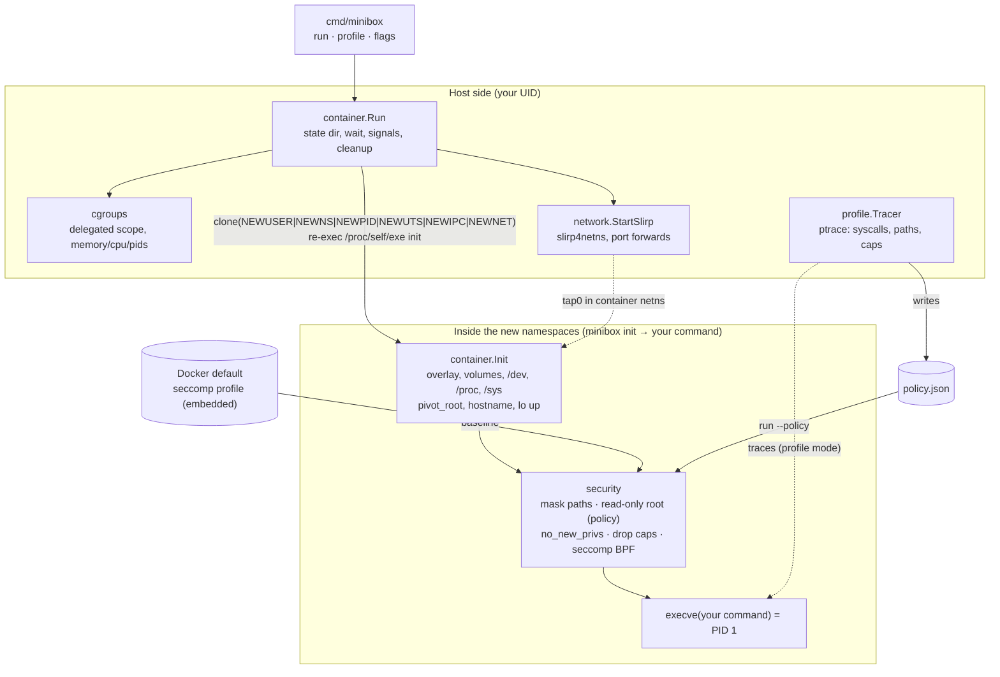

<div align="center">

# minibox

**A rootless Linux container runtime that learns what your app needs, then locks it down to exactly that.**

[](go.mod)
[](#requirements)
[](#how-it-works)
[](docs/phase2-cgroups.md)
[](docs/phase4-security.md)
[](LICENSE)

[Highlights](#highlights) ·
[How it works](#how-it-works) ·
[Quick start](#quick-start) ·
[Demo](#demo) ·
[Demo UI](#demo-ui) ·
[Usage](#usage) ·
[Results](#results) ·
[Limitations](#limitations) ·
[Related work](#related-work) ·
[Docs](#documentation)

</div>

---

Most containers run with a generic security profile: the same few hundred
syscalls and the same capabilities whatever the application. minibox runs
containers **without root** and adds a two-step workflow to give each app
only what it uses:

```sh
minibox profile -o app.json images/alpine ./my-app    # 1. watch what the app actually does
minibox run --policy app.json images/alpine ./my-app  # 2. allow only that, deny everything else
```

The generated policy is a seccomp allowlist with default deny, the minimal
capability set, and a read-only root filesystem with the observed write
locations as the only exceptions.

minibox started as an Operating Systems course project. It's written from
scratch in Go using only the standard library and `golang.org/x/sys/unix`.

## Highlights

| | |
|---|---|
| **Rootless from start to finish** | User namespaces, delegated cgroups and user-mode networking. No `sudo` and no setuid helpers. |
| **Real isolation** | 6 namespaces (user, mount, PID, UTS, IPC, net), an overlayfs root, `pivot_root`, and fresh `/proc` and `/sys`. |
| **Resource limits** | cgroups v2 memory, CPU and PID limits. The container is born inside its cgroup via `clone3(CLONE_INTO_CGROUP)`. |
| **Networking** | `--net bridge` gives outbound NAT, DNS and published ports via slirp4netns. `--net none` is the default. |
| **Docker-grade baseline** | Docker's default capabilities and its unmodified seccomp profile, compiled to BPF by **our own compiler**. Masked `/proc` and `/sys` paths and `no_new_privs`. |
| **Profile → enforce** | A ptrace tracer records syscalls, file reads/writes and capability needs, then writes a least-privilege `policy.json`. |
| **Measured, not claimed** | 17 attacks are run under 3 configurations, plus overhead benchmarks. Every number in this README is produced by a script in the repo. |
| **See it live** | `minibox ui` is a browser dashboard that runs the real commands: live cgroup meters, syscalls appearing as a program makes them, attacks filling in a matrix, one syscall stepping through the BPF filter. |

## How it works

A container is an ordinary Linux process. The kernel shows it a restricted
view of the system and limits what it can do. minibox sets up that view and
those limits, then replaces itself with your command.

| Question | Kernel feature | Code |
|----------|----------------|------|
| What can it **see**? | namespaces, overlayfs, `pivot_root` | [`internal/container`](internal/container) |
| How much can it **use**? | cgroups v2 | [`internal/cgroups`](internal/cgroups) |
| Who can it **talk to**? | network namespace + slirp4netns | [`internal/network`](internal/network) |
| What may it **do**? | capabilities, seccomp-BPF, masked/read-only mounts, `no_new_privs` | [`internal/security`](internal/security) |
| What does it actually **need**? | ptrace | [`internal/profile`](internal/profile) |



<details>
<summary><b>What happens during <code>minibox run</code>, step by step</b></summary>

1. **Host side.** minibox re-runs itself in a delegated systemd scope, if
   needed, and creates a cgroup with your limits and a state directory.
2. **clone.** It starts `/proc/self/exe init` in new user, mount, PID, UTS,
   IPC and network namespaces, directly inside the cgroup. Container UID 0
   maps to your UID.
3. **Network.** With `--net bridge`, slirp4netns attaches a `tap0` device
   to the new network namespace.
4. **Filesystem.** init mounts the overlay (image = read-only lower layer),
   `/dev`, `/proc` and `/sys`, then calls `pivot_root` and detaches the old
   root.
5. **Lock down.** init masks sensitive paths, remounts the root read-only
   (policy mode), sets `no_new_privs`, drops capabilities and installs the
   seccomp filter.
6. **exec.** init calls `execve` on your command, which becomes PID 1.
7. **Cleanup.** The host side waits, forwards signals, reports
   OOM kills and refused forks, and removes the cgroup, slirp4netns and the
   state directory.

</details>

Plain-language explanation of every concept, with pointers into the code:
**[docs/how-it-works.md](docs/how-it-works.md)**.

## Quick start

### Requirements

- Linux ≥ 5.11, x86_64, with **cgroups v2** and **unprivileged user namespaces**.
  On Ubuntu 24.04+ this also needs `kernel.apparmor_restrict_unprivileged_userns=0`.
- Go 1.27+
- Optional: `slirp4netns` for `--net bridge`

Development and testing used Ubuntu Server 26.04.1 (kernel 7.0) in VirtualBox.

### Build and check

```sh
git clone https://github.com/hardik-bharti/minibox.git && cd minibox
make check-env     # checks kernel features and explains how to fix anything missing
make image         # downloads the Alpine minirootfs into images/alpine (SHA-256 verified)
make build         # -> bin/minibox
make test          # unit tests
make smoke         # end-to-end checks of every feature, in this machine
```

### Your first container

```sh
$ ./bin/minibox run --hostname demo images/alpine sh -c 'id -u; hostname; cat /proc/self/uid_map'
0
demo
         0       1000          1
```

You're root inside the container (UID 0) and still yourself outside it
(UID 1000).

## Demo

```sh
B=./bin/minibox

# Isolation: own PIDs, hostname and filesystem
$B run --hostname demo images/alpine sh -c 'id; hostname; ps'

# Resource limits: a memory hog is OOM-killed, a fork tree is capped
$B run --memory 50m --stats images/alpine dd if=/dev/zero of=/dev/null bs=200M count=1
$B run --pids 20 --stats images/alpine sh -c 'for i in $(seq 50); do sleep 1 & done; wait'

# Networking: none by default; bridge = rootless outbound + published ports
$B run images/alpine ip addr
$B run --net bridge images/alpine wget -qO- http://example.com | head -3

# Baseline security: the same command, unhardened vs default
$B run --security none images/alpine mount -t tmpfs x /mnt && echo "mount allowed"
$B run images/alpine mount -t tmpfs x /mnt          # mount: permission denied
$B run images/alpine grep -E 'CapEff|Seccomp|NoNewPrivs' /proc/self/status
```

### Profile → enforce

```sh
$ $B profile -o demo.json images/alpine sh -c 'echo hi > /tmp/f && echo saved'
saved
minibox profile: 16 syscalls, 0 capabilities [], 1 writable paths [/tmp] -> demo.json

$ $B run --policy demo.json images/alpine sh -c 'echo hi > /tmp/f && echo saved'
saved
$ $B run --policy demo.json images/alpine sh -c 'echo x > /etc/f 2>/dev/null || echo "blocked: read-only"'
blocked: read-only
$ $B run --policy demo.json images/alpine sh -c 'ls / >/dev/null 2>&1 || echo "blocked: syscalls not in policy"'
blocked: syscalls not in policy
```

The generated policy (`observed` section shortened):

```json
{
  "minibox_policy": 1,
  "command": ["sh", "-c", "echo hi > /tmp/f && echo saved"],
  "syscalls": ["arch_prctl", "brk", "close", "dup2", "fcntl", "getcwd", "getpid", "getppid",
               "getuid", "mmap", "mprotect", "open", "rt_sigaction", "rt_sigprocmask",
               "set_tid_address", "write"],
  "capabilities": [],
  "writable_paths": ["/tmp"],
  "observed": { "syscall_counts": { "...": 0 }, "read_paths": [], "written_paths": ["/tmp"] }
}
```

## Demo UI

```sh
make ui        # http://127.0.0.1:7070 inside the VM
```

A dashboard for demos and the viva, with five panels: isolation (host vs
container, side by side), resource limits (live cgroup charts up to the
OOM kill), profile and enforce (syscalls appearing live, the policy
against Docker's 309), the attack suite, and one syscall traced through the
real seccomp program. Every panel shows the exact `minibox` command it
runs. It listens on loopback only. From the host, use
`ssh -p 2222 -L 7070:127.0.0.1:7070 <user>@127.0.0.1` and open the same
URL. Details and the safety design: [docs/phase8-demo-ui.md](docs/phase8-demo-ui.md).

For explaining rather than demonstrating, **[docs/explainer.html](docs/explainer.html)**
is a self-contained page. It steps through `minibox run`, traces syscalls
through the BPF our compiler emits, and shows the attack results. Its data
is regenerated with `make explainer`.

## Usage

```
minibox run     [flags] <rootfs> <cmd> [args...]
minibox profile [flags] [-o policy.json] [--merge] [--events FILE] <rootfs> <cmd> [args...]
minibox ui      [--addr 127.0.0.1:7070]
```

Flags go **before** the rootfs. Everything after the command is passed to
the command.

| Flag | Meaning |
|------|---------|
| `--hostname NAME` | Container hostname (default: the container ID) |
| `--memory SIZE` | Memory limit (`64m`, `1g`). Swap is disabled. Going over gets the process OOM-killed. |
| `--cpus N` | CPU limit, e.g. `0.5` |
| `--pids N` | Max processes + threads (minimum 8) |
| `--stats` | Print cgroup usage (CPU, memory peak, OOM kills, pids) on exit |
| `--net none\|bridge` | `none` (default): loopback only. `bridge`: 10.0.3.100, DNS, outbound NAT via slirp4netns |
| `-p HOST:CONTAINER[/udp]` | Publish a port (bridge only, host port ≥ 1024, repeatable) |
| `-v HOST:CONTAINER[:ro]` | Bind-mount a host directory (repeatable) |
| `--security baseline\|none` | `baseline` (default): Docker-like hardening. `none`: namespaces only |
| `--policy FILE` | Enforce a generated policy (instead of `--security`) |
| `-o FILE`, `--merge` | *profile only*: output file, and merging with an existing policy to combine several runs |
| `--events FILE` | *profile only*: also write live observations as JSON lines (used by `minibox ui`) |

**Exit status:** the command's exit code, `128+N` if killed by signal N, or
`127` if setup failed. Ctrl-C is forwarded to the container. Press it again
to force-kill. State lives in `~/.local/share/minibox/containers/<id>`
(override with `MINIBOX_ROOT`) and is deleted on exit.

## Results

All results come from the development VM (Ubuntu 26.04.1, kernel 7.0, 4
vCPUs in VirtualBox). Re-run them with:

```sh
make bench-image   # images/bench = Alpine + python3 + busybox httpd
make attacks       # -> results/attacks.{csv,md}
make bench         # -> results/bench.{csv,md}, results/syscalls.{csv,md}  (about 10 minutes)
```

`scripts/update-docs-results.py` copies the tables below in from `results/`.
They are never edited by hand. Method, analysis and threats to validity:
**[docs/phase6-evaluation.md](docs/phase6-evaluation.md)**.

### Attack suite: 17 attacks × 3 configurations

*none* = namespaces only · *baseline* = default hardening + `--pids 64 --memory 256m` ·
*policy* = policy generated by profiling a benign service + the same limits.

<!-- results:attacks-summary -->
| Config | Blocked | Allowed | Error |
|---|---|---|---|
| none | 7/17 | 10 | 0 |
| baseline | 16/17 | 1 | 0 |
| policy | 17/17 | 0 | 0 |
<!-- /results:attacks-summary -->

<details>
<summary><b>Per-attack results</b></summary>

<!-- results:attacks-matrix -->
| # | Attack | none | baseline | policy |
|---|---|---|---|---|
| 1 | mount a filesystem (tmpfs on /mnt) (`mount`) | ALLOWED | BLOCKED | BLOCKED |
| 2 | create a user namespace to regain all capabilities (`unshare`) | ALLOWED | BLOCKED | BLOCKED |
| 3 | load a kernel module (init_module) (`kernel-module`) | BLOCKED | BLOCKED | BLOCKED |
| 4 | ptrace-attach to a sibling process (`ptrace`) | ALLOWED | BLOCKED | BLOCKED |
| 5 | open /proc/sysrq-trigger for writing (`sysrq`) | BLOCKED | BLOCKED | BLOCKED |
| 6 | write /proc/sys/net/ipv4/ip_forward (`proc-sys`) | ALLOWED | BLOCKED | BLOCKED |
| 7 | read host kernel info (/proc/interrupts) (`kernel-info`) | ALLOWED | BLOCKED | BLOCKED |
| 8 | hold 500 processes (bounded fork bomb) (`fork-bomb`) | ALLOWED | BLOCKED | BLOCKED |
| 9 | allocate and touch 1 GiB (`memory`) | ALLOWED | BLOCKED | BLOCKED |
| 10 | open a raw socket (SOCK_RAW) (`raw-socket`) | ALLOWED | ALLOWED | BLOCKED |
| 11 | change the hostname (sethostname) (`hostname`) | ALLOWED | BLOCKED | BLOCKED |
| 12 | set the system clock (clock_settime) (`clock`) | BLOCKED | BLOCKED | BLOCKED |
| 13 | add a key to the kernel keyring (`keyring`) | ALLOWED | BLOCKED | BLOCKED |
| 14 | use bpf() (BPF_MAP_CREATE) (`bpf`) | BLOCKED | BLOCKED | BLOCKED |
| 15 | create a block device node for the host disk (`mknod`) | BLOCKED | BLOCKED | BLOCKED |
| 16 | classic chroot + '..' escape to the host fs (`chroot-escape`) | BLOCKED | BLOCKED | BLOCKED |
| 17 | read another container's files (`other-container`) | BLOCKED | BLOCKED | BLOCKED |
<!-- /results:attacks-matrix -->

</details>

- **Rootless namespaces alone** stop attacks that need privilege in the
  initial namespace (kernel modules, clock, bpf, device nodes).
- **Baseline** stops everything else except raw sockets, because Docker keeps `CAP_NET_RAW`.
- **Generated policy** also blocks raw sockets. While building the suite, it caught a real
  weakness in our first policy design: a name-only allowlist let
  `clone(CLONE_NEWUSER)` through. See
  [the write-up](docs/phase6-evaluation.md#a-weakness-the-suite-found-and-the-fix).

### Attack surface: allowed syscalls

<!-- results:syscalls -->
| Profile | Allowed syscalls | % of Docker's | Allowed but not in Docker's | Capabilities | Writable paths |
|---|---|---|---|---|---|
| docker-default (baseline) | 309 | 100.0% | - | 14 | all (rw root) |
| attack-probe | 42 | 13.6% | - | 0 | /tmp |
| busybox-http | 28 | 9.1% | - | 0 | none (read-only root) |
| cpu-python | 31 | 10.0% | - | 0 | none (read-only root) |
| python-http | 49 | 15.9% | - | 0 | none (read-only root) |
| startup | 11 | 3.6% | - | 0 | none (read-only root) |
| syscall-dd | 19 | 6.1% | - | 0 | none (read-only root) |
<!-- /results:syscalls -->

### Overhead

In short: there's no measurable cost for the web servers, and startup takes
about a millisecond longer. The only measurable per-syscall cost is in the
deliberately syscall-bound `dd` worst case. There, by median, policy is no
worse than baseline.

<details>
<summary><b>Full benchmark table</b> (mean ± sd, median, overhead vs <i>none</i>)</summary>

<!-- results:bench -->
Environment: minibox-dev, kernel 7.0.0-38-generic, 4 vCPUs, 2026-10-25 16:36 UTC. Repetitions per cell: 5 (HTTP: 10 s of load each after 1 s warm-up, 1 client, new connection per request, through slirp4netns in every config).

Startup has 30 repetitions per cell (it is cheap).

Cells: mean ± sample standard deviation, then the median. *Overhead* compares each configuration with `none`, by mean and by median (positive = worse: slower, or fewer requests/s). The median is less sensitive to a single slow run.

| Workload | Metric | none | baseline | policy | baseline overhead (mean / median) | policy overhead (mean / median) |
|---|---|---|---|---|---|---|
| startup | wall_time (ms) | 8.00 ± 1.32 (med 7.71) | 9.31 ± 1.51 (med 9.07) | 8.98 ± 1.47 (med 8.75) | +16.3% / +17.6% | +12.2% / +13.5% |
| cpu-python | wall_time (ms) | 609.99 ± 35.41 (med 609.14) | 657.39 ± 38.42 (med 646.41) | 628.50 ± 27.87 (med 638.10) | +7.8% / +6.1% | +3.0% / +4.8% |
| syscall-dd | wall_time (ms) | 204.20 ± 11.72 (med 205.50) | 231.85 ± 12.49 (med 235.37) | 251.29 ± 46.06 (med 227.82) | +13.5% / +14.5% | +23.1% / +10.9% |
| python-http | rps (req/s) | 1622.51 ± 70.13 (med 1657.41) | 1646.76 ± 23.26 (med 1647.48) | 1631.83 ± 56.75 (med 1644.07) | -1.5% / +0.6% | -0.6% / +0.8% |
| python-http | lat_mean_ms (ms) | 0.62 ± 0.03 (med 0.60) | 0.61 ± 0.01 (med 0.61) | 0.61 ± 0.02 (med 0.61) | -1.6% / +0.5% | -0.7% / +0.7% |
| python-http | lat_p50_ms (ms) | 0.56 ± 0.02 (med 0.55) | 0.55 ± 0.01 (med 0.55) | 0.56 ± 0.02 (med 0.55) | -1.7% / +0.2% | -0.1% / +0.7% |
| python-http | lat_p99_ms (ms) | 1.52 ± 0.08 (med 1.50) | 1.48 ± 0.07 (med 1.49) | 1.48 ± 0.09 (med 1.46) | -2.2% / -0.7% | -2.7% / -2.7% |
| busybox-http | rps (req/s) | 1601.69 ± 344.64 (med 1407.75) | 1285.98 ± 528.19 (med 1244.46) | 1358.06 ± 71.94 (med 1361.69) | +19.7% / +11.6% | +15.2% / +3.3% |
| busybox-http | lat_mean_ms (ms) | 0.65 ± 0.13 (med 0.71) | 0.74 ± 0.15 (med 0.80) | 0.74 ± 0.04 (med 0.73) | +14.6% / +12.4% | +14.2% / +3.4% |
| busybox-http | lat_p50_ms (ms) | 0.25 ± 0.01 (med 0.25) | 0.25 ± 0.00 (med 0.25) | 0.25 ± 0.00 (med 0.25) | -0.4% / -1.2% | +0.6% / -0.4% |
| busybox-http | lat_p99_ms (ms) | 0.81 ± 0.05 (med 0.81) | 0.80 ± 0.04 (med 0.80) | 0.83 ± 0.02 (med 0.83) | -1.8% / -0.7% | +2.7% / +2.9% |
<!-- /results:bench -->

</details>

## Project layout

```
cmd/minibox/          CLI: run, profile, flag parsing
internal/container/   namespaces, overlayfs, /dev /proc /sys, pivot_root, exec, cleanup
internal/cgroups/     cgroup v2 limits, systemd delegation, usage stats
internal/network/     loopback, slirp4netns, port forwarding
internal/security/    capabilities, seccomp-BPF compiler, Docker profile, masked paths, policies
internal/profile/     ptrace tracer, recorder, policy generation, live events
internal/ui/          `minibox ui`: demo dashboard (server + embedded page)
tests/smoke.sh        end-to-end checks for every phase
tests/attacks/        attack probe + runner (17 attacks × 3 configs)
tests/ui/             optional headless-browser check of the dashboard
bench/  tools/        benchmark harness, load generator, policy statistics, BPF dump
scripts/              environment check, image download, result copying
docs/                 design notes per phase, concepts, viva prep
results/              generated CSV and Markdown results
```

## Limitations

- **Coverage of generated policies.** A policy contains only what the profiled
  run did, so untested code paths may fail with `EPERM`. Even the environment
  matters: busybox `cat` uses `sendfile()` when stdout is a pipe or a file and
  `read()` otherwise, so a policy profiled one way can fail when run the other
  way. Profile in the deployment environment with realistic workloads, and
  combine runs with `--merge`.
- **Capabilities are inferred, not observed.** ptrace can't see the kernel's
  `capable()` checks. eBPF could, but it needs root on this kernel. Each
  inferred capability is stored with its reason so it can be reviewed.
- **Name-level syscall filtering.** Policies don't filter arguments, except
  for the `clone` namespace-flag rule.
- **Networking.** slirp4netns is slower than a kernel veth/bridge, and
  containers can't reach each other. Host ports must be ≥ 1024.
- **Single-UID containers.** Only container root is mapped (no `newuidmap`).
  Files owned by other UIDs in an image show up as `nobody`.
- **Scope.** x86_64 only. No OCI images or bundles (a rootfs directory is the
  image). No `ps` or `exec` commands. If minibox itself is SIGKILLed, its
  state directory stays behind (the container still dies).
- **Evaluation** ran on one VM with five repetitions per cell. Compare the
  configurations with each other, not with other systems.

## Related work

| Project | What it is | How minibox differs |
|---------|------------|---------------------|
| **Docker / runc** | Production OCI runtime. Root daemon by default, optional rootless mode. Static default seccomp profile and capability set. | Reuses Docker's profile and capabilities as its *baseline*, but is rootless-only and tiny, and adds per-application profile→enforce. Uses its own seccomp compiler, while runc uses libseccomp. |
| **Bocker** (Docker in ~100 lines of bash) | Teaching demo built on `unshare`, btrfs, cgroups v1 and iptables. Needs root. | Rootless, with cgroups v2 and overlayfs. Adds a security layer and an evaluation. |
| **Liz Rice, "Containers From Scratch"** | Talk and code showing namespaces, chroot and cgroups in Go. | Same starting point (the Go re-exec trick), extended with `pivot_root`, user namespaces, networking, seccomp/capabilities and policy generation. |
| **Red Hat oci-seccomp-bpf-hook** | OCI hook that records syscalls with eBPF and writes a seccomp profile. Needs root. | Records with ptrace, so needs no privileges. Its policy also covers capabilities and writable paths, and it's evaluated against attacks. |
| **SlimToolkit (DockerSlim)** | Analyses containers to shrink images and to generate seccomp and AppArmor profiles. | Doesn't shrink images. Enforces least privilege in its own runtime, with a read-only root built from observed writes. |
| **Podman (rootless) + slirp4netns / pasta** | Production rootless runtime. | Same rootless building blocks, at teaching scale. |

## Documentation

| Document | Contents |
|----------|----------|
| [PROJECT_DOCUMENTATION.md](PROJECT_DOCUMENTATION.md) | **Complete reference**: features, CLI, policy format, testing, results, design decisions, troubleshooting |
| [docs/how-it-works.md](docs/how-it-works.md) | Every OS concept in plain language, with code pointers |
| [docs/phase1-isolation.md](docs/phase1-isolation.md) | Namespaces, overlay, `pivot_root`, the `/proc` gotcha |
| [docs/phase2-cgroups.md](docs/phase2-cgroups.md) | cgroup v2 limits, rootless delegation |
| [docs/phase3-networking.md](docs/phase3-networking.md) | slirp4netns vs veth: which steps need root and why |
| [docs/phase4-security.md](docs/phase4-security.md) | Capabilities, seccomp compiler, masked paths |
| [docs/phase5-profiling.md](docs/phase5-profiling.md) | ptrace vs eBPF, tracer design, policy format |
| [docs/phase6-evaluation.md](docs/phase6-evaluation.md) | Attack suite, benchmarks, analysis |
| [docs/phase8-demo-ui.md](docs/phase8-demo-ui.md) | `minibox ui` and the explainer: panels, design, safety |
| [docs/explainer.html](docs/explainer.html) | Interactive explainer (lifecycle, seccomp walkthrough, attacks) |
| [docs/viva-prep.md](docs/viva-prep.md) | 20 likely examiner questions with answers |
| [docs/team-split.md](docs/team-split.md) | How the codebase splits among 3 team members |
| [docs/PROGRESS.md](docs/PROGRESS.md) | Phase-by-phase log and open issues |

## Acknowledgements

minibox reuses Docker's default seccomp profile
([moby/profiles](https://github.com/moby/profiles), embedded unmodified with
its SHA-256 pinned) and the Alpine Linux minirootfs. It draws on ideas from
runc, Podman's rootless networking, and Liz Rice's *Containers From Scratch*.

## License

[MIT](LICENSE). The embedded Docker seccomp profile
(`internal/security/profiles/docker-default.json`) comes from moby/profiles and
keeps its own Apache-2.0 license.
