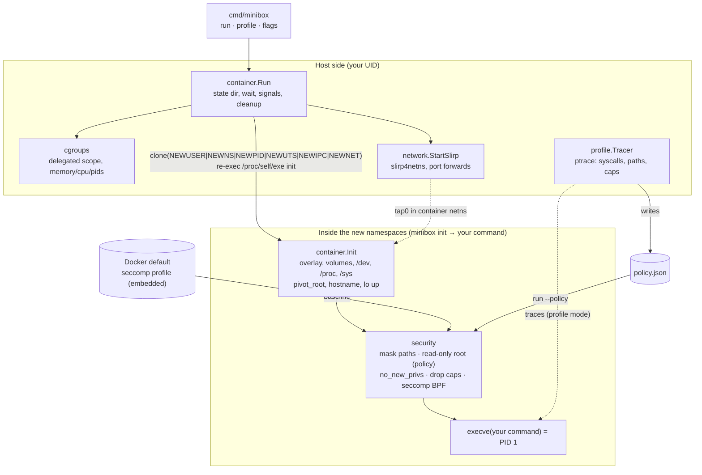

# minibox

A rootless Linux container runtime written in Go, with **automatic
least-privilege hardening**: `minibox profile` traces what an application
actually does and writes a policy, and `minibox run --policy` enforces exactly
that: only the syscalls it used, only the capabilities it needed, and a
read-only filesystem except where it wrote.

Built from scratch as an Operating Systems course project. It covers namespaces,
cgroups v2, overlayfs, pivot_root, user-mode networking, capabilities, seccomp-BPF
and ptrace. No root needed at any point.

- **Run** containers: 6 namespaces, overlay root, cgroup limits, optional network.
- **Harden** them by default like Docker: default capability set, Docker's seccomp
  profile compiled by our own BPF compiler, masked `/proc`/`/sys` paths,
  no_new_privs.
- **Profile → enforce**: generate a per-application policy that cuts the allowed
  syscalls to a small fraction of Docker's (see [Results](#results)).
- **Evaluate**: 17 attacks under three configurations, plus overhead benchmarks.
  Every number in this README comes from a script you can re-run.

## Contents

[Architecture](#architecture) · [Quick start](#quick-start) · [Demo](#demo) ·
[Usage](#usage) · [Results](#results) · [Limitations](#limitations) ·
[Related work](#related-work) · [Documentation](#documentation)

## Architecture



| Package | OS concepts | Phase |
|---------|-------------|-------|
| `internal/container` | user/mount/PID/UTS/IPC/net namespaces, overlayfs, pivot_root, procfs/sysfs, bind mounts | 1 |
| `internal/cgroups` | cgroup v2, systemd delegation, `CLONE_INTO_CGROUP` | 2 |
| `internal/network` | network namespace, loopback ioctl, slirp4netns (user-mode TCP/IP) | 3 |
| `internal/security` | capabilities (bounding set), seccomp-BPF compiler, Docker profile, masked paths, no_new_privs, policy enforcement | 4, 5 |
| `internal/profile` | ptrace (`PTRACE_GET_SYSCALL_INFO`, fork following), `/proc/<pid>/mem`, policy generation | 5 |
| `tests/attacks`, `bench`, `tools` | attack probe, harnesses, load generator, profile statistics | 6 |

Plain-language tour of every concept and where it lives in the code:
**[docs/how-it-works.md](docs/how-it-works.md)**.

## Quick start

Requirements: Linux ≥ 5.11 with cgroups v2 and unprivileged user namespaces
(developed on Ubuntu 26.04.1, kernel 7.0, in VirtualBox), Go 1.27+. Optional:
`slirp4netns` for `--net bridge`. `make check-env` checks all of this and says how
to fix what's missing.

```sh
make check-env     # verify kernel/VM features
make image         # download Alpine minirootfs -> images/alpine (SHA-256 verified)
make build         # bin/minibox
make test          # unit tests
make smoke         # end-to-end checks of every phase in this VM
```

For the evaluation:

```sh
make bench-image   # images/bench = Alpine + python3 + busybox httpd (apk --root via a volume)
make attacks       # results/attacks.{csv,md}
make bench         # results/bench.{csv,md}, results/syscalls.{csv,md} (about 10 minutes)
```

## Demo

```sh
B=./bin/minibox

# 1. Isolation: root inside, you outside; own PIDs, hostname, filesystem
$B run --hostname demo images/alpine sh -c 'id; hostname; ps; cat /proc/self/uid_map'

# 2. Resource limits: a memory hog is OOM-killed, a fork tree is capped
$B run --memory 50m --stats images/alpine dd if=/dev/zero of=/dev/null bs=200M count=1
$B run --pids 20 --stats images/alpine sh -c 'for i in $(seq 50); do sleep 1 & done; wait'

# 3. Networking: none by default; bridge = rootless outbound + published ports
$B run images/alpine ip addr
$B run --net bridge images/alpine wget -qO- http://example.com | head -3

# 4. Baseline security: the same command, unhardened vs default
$B run --security none images/alpine mount -t tmpfs x /mnt && echo "mount allowed"
$B run images/alpine mount -t tmpfs x /mnt          # permission denied
$B run images/alpine grep -E 'CapEff|Seccomp|NoNewPrivs' /proc/self/status

# 5. Profile -> enforce
$B profile -o demo.json images/alpine sh -c 'echo hi > /tmp/f && echo saved'
head -30 demo.json                       # a short syscall list, no capabilities, writable: /tmp
$B run --policy demo.json images/alpine sh -c 'echo hi > /tmp/f && echo saved'                  # saved
$B run --policy demo.json images/alpine sh -c 'echo x > /etc/f 2>/dev/null || echo "blocked: read-only"'
$B run --policy demo.json images/alpine sh -c 'ls / >/dev/null 2>&1 || echo "blocked: syscalls not in policy"'

# 6. Evaluation
make attacks && cat results/attacks.md
```

## Usage

```
minibox run     [flags] <rootfs> <cmd> [args...]
minibox profile [flags] [-o policy.json] [--merge] <rootfs> <cmd> [args...]
```

Flags go **before** the rootfs. Everything after the command belongs to the command.

| Flag | Meaning |
|------|---------|
| `--hostname NAME` | Container hostname (default: the container ID) |
| `--memory SIZE` | Memory limit (`64m`, `1g`); swap disabled; exceeding it gets the process OOM-killed |
| `--cpus N` | CPU limit, e.g. `0.5` |
| `--pids N` | Max processes + threads (minimum 8) |
| `--stats` | Print cgroup usage (CPU, memory peak, OOM kills, pids) on exit |
| `--net none\|bridge` | `none` (default): loopback only. `bridge`: 10.0.3.100, DNS, outbound NAT via slirp4netns |
| `-p HOST:CONTAINER[/udp]` | Publish a port (bridge only, host port ≥ 1024, repeatable) |
| `-v HOST:CONTAINER[:ro]` | Bind-mount a host directory (repeatable) |
| `--security baseline\|none` | `baseline` (default): Docker-like hardening. `none`: namespaces only |
| `--policy FILE` | Enforce a generated policy (instead of `--security`) |
| `-o FILE`, `--merge` | *profile only*: output file; union with an existing policy to combine runs |

Exit status: the command's exit code, `128+N` if killed by signal N, `127` if
setup failed. Ctrl-C is forwarded to the container; press it again to force-kill.
State lives in `~/.local/share/minibox/containers/<id>` (override with
`MINIBOX_ROOT`) and is deleted on exit.

## Results

Generated on the development VM (Ubuntu 26.04.1, kernel 7.0, 4 vCPUs in
VirtualBox). Re-run with `make attacks` / `make bench`. The tables below are
copied in by `scripts/update-docs-results.py` and never edited by hand. Full
analysis, method and threats to validity: **[docs/phase6-evaluation.md](docs/phase6-evaluation.md)**.

### Attack suite: 17 attacks × 3 configurations

*none* = namespaces only; *baseline* = Phase 4 defaults + `--pids 64 --memory 256m`;
*policy* = policy generated by profiling a benign service + the same limits.

<!-- results:attacks-matrix -->
| # | Attack | none | baseline | policy |
|---|---|---|---|---|
| 1 | mount a filesystem (tmpfs on /mnt) (`mount`) | ALLOWED | BLOCKED | BLOCKED |
| 2 | create a user namespace to regain all capabilities (`unshare`) | ALLOWED | BLOCKED | BLOCKED |
| 3 | load a kernel module (init_module) (`kernel-module`) | BLOCKED | BLOCKED | BLOCKED |
| 4 | ptrace-attach to a sibling process (`ptrace`) | ALLOWED | BLOCKED | BLOCKED |
| 5 | open /proc/sysrq-trigger for writing (`sysrq`) | BLOCKED | BLOCKED | BLOCKED |
| 6 | write /proc/sys/net/ipv4/ip_forward (`proc-sys`) | ALLOWED | BLOCKED | BLOCKED |
| 7 | read host kernel info (/proc/interrupts) (`kernel-info`) | ALLOWED | BLOCKED | BLOCKED |
| 8 | hold 500 processes (bounded fork bomb) (`fork-bomb`) | ALLOWED | BLOCKED | BLOCKED |
| 9 | allocate and touch 1 GiB (`memory`) | ALLOWED | BLOCKED | BLOCKED |
| 10 | open a raw socket (SOCK_RAW) (`raw-socket`) | ALLOWED | ALLOWED | BLOCKED |
| 11 | change the hostname (sethostname) (`hostname`) | ALLOWED | BLOCKED | BLOCKED |
| 12 | set the system clock (clock_settime) (`clock`) | BLOCKED | BLOCKED | BLOCKED |
| 13 | add a key to the kernel keyring (`keyring`) | ALLOWED | BLOCKED | BLOCKED |
| 14 | use bpf() (BPF_MAP_CREATE) (`bpf`) | BLOCKED | BLOCKED | BLOCKED |
| 15 | create a block device node for the host disk (`mknod`) | BLOCKED | BLOCKED | BLOCKED |
| 16 | classic chroot + '..' escape to the host fs (`chroot-escape`) | BLOCKED | BLOCKED | BLOCKED |
| 17 | read another container's files (`other-container`) | BLOCKED | BLOCKED | BLOCKED |
<!-- /results:attacks-matrix -->

<!-- results:attacks-summary -->
| Config | Blocked | Allowed | Error |
|---|---|---|---|
| none | 7/17 | 10 | 0 |
| baseline | 16/17 | 1 | 0 |
| policy | 17/17 | 0 | 0 |
<!-- /results:attacks-summary -->

Rootless namespaces alone already stop attacks that need init-namespace
privilege (kernel modules, clock, bpf, device nodes). The baseline stops
everything else except raw sockets (Docker keeps `CAP_NET_RAW`). The generated
policy also blocks those. While building the suite, it caught a real weakness
in our first policy design: a name-only allowlist let
`clone(CLONE_NEWUSER)` through. See
[the write-up](docs/phase6-evaluation.md#a-weakness-the-suite-found-and-the-fix).

### Attack surface: allowed syscalls

<!-- results:syscalls -->
| Profile | Allowed syscalls | % of Docker's | Allowed but not in Docker's | Capabilities | Writable paths |
|---|---|---|---|---|---|
| docker-default (baseline) | 309 | 100.0% | - | 14 | all (rw root) |
| attack-probe | 42 | 13.6% | - | 0 | /tmp |
| busybox-http | 28 | 9.1% | - | 0 | none (read-only root) |
| cpu-python | 31 | 10.0% | - | 0 | none (read-only root) |
| python-http | 49 | 15.9% | - | 0 | none (read-only root) |
| startup | 11 | 3.6% | - | 0 | none (read-only root) |
| syscall-dd | 19 | 6.1% | - | 0 | none (read-only root) |
<!-- /results:syscalls -->

### Overhead

<!-- results:bench -->
Environment: minibox-dev, kernel 7.0.0-38-generic, 4 vCPUs, 2026-10-25 16:36 UTC. Repetitions per cell: 5 (HTTP: 10 s of load each after 1 s warm-up, 1 client, new connection per request, through slirp4netns in every config).

Startup has 30 repetitions per cell (it is cheap).

Cells: mean ± sample standard deviation, then the median. *Overhead* compares each configuration with `none`, by mean and by median (positive = worse: slower, or fewer requests/s). The median is less sensitive to a single slow run.

| Workload | Metric | none | baseline | policy | baseline overhead (mean / median) | policy overhead (mean / median) |
|---|---|---|---|---|---|---|
| startup | wall_time (ms) | 8.00 ± 1.32 (med 7.71) | 9.31 ± 1.51 (med 9.07) | 8.98 ± 1.47 (med 8.75) | +16.3% / +17.6% | +12.2% / +13.5% |
| cpu-python | wall_time (ms) | 609.99 ± 35.41 (med 609.14) | 657.39 ± 38.42 (med 646.41) | 628.50 ± 27.87 (med 638.10) | +7.8% / +6.1% | +3.0% / +4.8% |
| syscall-dd | wall_time (ms) | 204.20 ± 11.72 (med 205.50) | 231.85 ± 12.49 (med 235.37) | 251.29 ± 46.06 (med 227.82) | +13.5% / +14.5% | +23.1% / +10.9% |
| python-http | rps (req/s) | 1622.51 ± 70.13 (med 1657.41) | 1646.76 ± 23.26 (med 1647.48) | 1631.83 ± 56.75 (med 1644.07) | -1.5% / +0.6% | -0.6% / +0.8% |
| python-http | lat_mean_ms (ms) | 0.62 ± 0.03 (med 0.60) | 0.61 ± 0.01 (med 0.61) | 0.61 ± 0.02 (med 0.61) | -1.6% / +0.5% | -0.7% / +0.7% |
| python-http | lat_p50_ms (ms) | 0.56 ± 0.02 (med 0.55) | 0.55 ± 0.01 (med 0.55) | 0.56 ± 0.02 (med 0.55) | -1.7% / +0.2% | -0.1% / +0.7% |
| python-http | lat_p99_ms (ms) | 1.52 ± 0.08 (med 1.50) | 1.48 ± 0.07 (med 1.49) | 1.48 ± 0.09 (med 1.46) | -2.2% / -0.7% | -2.7% / -2.7% |
| busybox-http | rps (req/s) | 1601.69 ± 344.64 (med 1407.75) | 1285.98 ± 528.19 (med 1244.46) | 1358.06 ± 71.94 (med 1361.69) | +19.7% / +11.6% | +15.2% / +3.3% |
| busybox-http | lat_mean_ms (ms) | 0.65 ± 0.13 (med 0.71) | 0.74 ± 0.15 (med 0.80) | 0.74 ± 0.04 (med 0.73) | +14.6% / +12.4% | +14.2% / +3.4% |
| busybox-http | lat_p50_ms (ms) | 0.25 ± 0.01 (med 0.25) | 0.25 ± 0.00 (med 0.25) | 0.25 ± 0.00 (med 0.25) | -0.4% / -1.2% | +0.6% / -0.4% |
| busybox-http | lat_p99_ms (ms) | 0.81 ± 0.05 (med 0.81) | 0.80 ± 0.04 (med 0.80) | 0.83 ± 0.02 (med 0.83) | -1.8% / -0.7% | +2.7% / +2.9% |
<!-- /results:bench -->

In short: no measurable cost for the web servers. About a millisecond more
startup. A measurable per-syscall cost only in the deliberately syscall-bound
`dd` worst case, where policy is no worse than baseline by median.

## Limitations

- **Coverage of generated policies.** A policy contains only what the profiled
  run did. Untested code paths may hit `EPERM`. Even the environment matters:
  busybox `cat` uses `sendfile()` when stdout is a pipe or file but falls back to
  `read()` for other stdout types, so a policy profiled one way can fail when run
  the other way. Profile in the deployment environment, with realistic
  workloads, and combine runs with `--merge`.
- **Capabilities are inferred, not observed.** ptrace can't see the kernel's
  `capable()` checks (eBPF could, but needs root on this kernel). Each inferred
  capability is stored with its reason for review.
- **Name-level syscall filtering.** Policies don't filter arguments, except the
  `clone` namespace-flag rule.
- **Networking:** slirp4netns is slower than a kernel veth/bridge, and
  containers can't reach each other. Host ports must be ≥ 1024.
- **Single-UID containers:** only container root is mapped (no `newuidmap`).
  Files owned by other UIDs in an image show up as `nobody`.
- x86_64 only (syscall table, seccomp arch check). No OCI image or bundle
  support: a rootfs directory is the image. No `minibox ps`/`exec`. A
  SIGKILLed minibox leaves its state dir behind (the container itself dies).
- Evaluation on one VM with five repetitions per cell. Compare configurations
  with each other, not with other systems.

## Related work

| Project | What it is | How minibox differs |
|---------|------------|---------------------|
| **Docker / runc** | Production OCI runtime. Root daemon by default, rootless mode optional. Static default seccomp profile and capability set. | minibox reuses Docker's profile and caps as its *baseline*, but is rootless-only, tiny, and adds per-application profile→enforce. Our seccomp compiler is our own (runc uses libseccomp). |
| **Bocker** (Docker in ~100 lines of bash) | Teaching demo using `unshare`, btrfs, cgroups v1, iptables. Needs root. | Rootless, cgroups v2, overlayfs, and a security layer and evaluation that Bocker doesn't attempt. |
| **Liz Rice, "Containers From Scratch"** | Talk/code showing namespaces + chroot + cgroups in Go. | Same starting point (Go re-exec trick), extended with pivot_root, user namespaces, networking, seccomp/caps and policy generation. |
| **Red Hat oci-seccomp-bpf-hook** | OCI hook that records a container's syscalls with eBPF and writes a seccomp profile (Podman `--annotation`). Needs root for eBPF. | minibox records with ptrace, so no privileges. Its policy also covers capabilities and writable paths, and it's evaluated against attacks. |
| **SlimToolkit (DockerSlim)** | Analyses a running container to shrink images, and generates seccomp and AppArmor profiles. | minibox doesn't shrink images. It focuses on enforcing least privilege in its own runtime, with a read-only root from observed writes and an attack-based evaluation. |
| **Podman (rootless) + slirp4netns / pasta** | Production rootless runtime. | Same rootless building blocks (user namespaces, delegated cgroups, slirp4netns), at teaching scale. |

## Documentation

| Document | Contents |
|----------|----------|
| [docs/how-it-works.md](docs/how-it-works.md) | Every OS concept in plain language, with code pointers |
| [docs/phase1-isolation.md](docs/phase1-isolation.md) | Namespaces, overlay, pivot_root, `/proc` gotcha |
| [docs/phase2-cgroups.md](docs/phase2-cgroups.md) | cgroup v2 limits, rootless delegation |
| [docs/phase3-networking.md](docs/phase3-networking.md) | slirp4netns vs veth (which steps need root and why) |
| [docs/phase4-security.md](docs/phase4-security.md) | Capabilities, seccomp compiler, masked paths |
| [docs/phase5-profiling.md](docs/phase5-profiling.md) | ptrace vs eBPF, tracer design, policy format |
| [docs/phase6-evaluation.md](docs/phase6-evaluation.md) | Attack suite, benchmarks, analysis |
| [docs/viva-prep.md](docs/viva-prep.md) | 20 likely examiner questions with answers |
| [docs/team-split.md](docs/team-split.md) | Suggested split of the codebase among 3 members |
| [docs/PROGRESS.md](docs/PROGRESS.md) | Phase-by-phase log and open issues |
