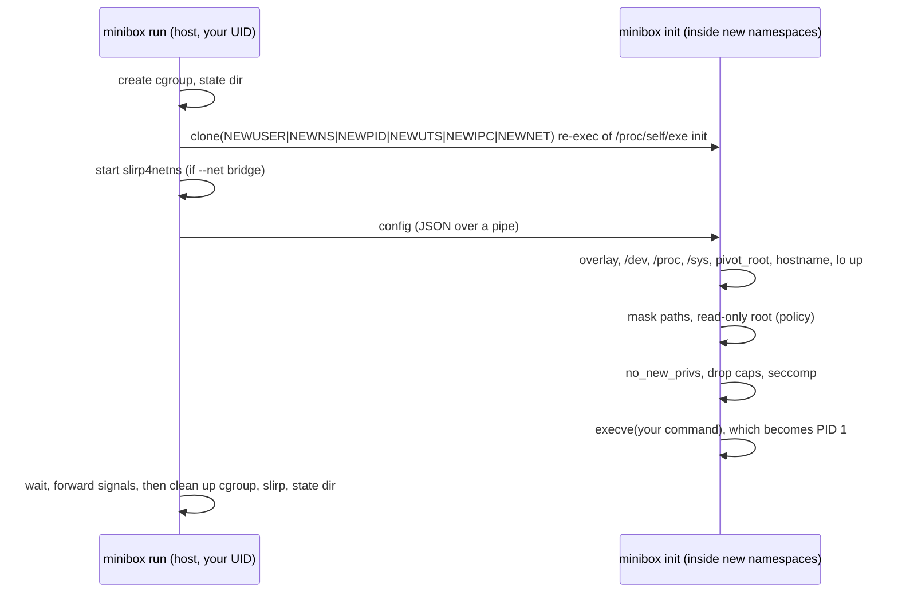

# How minibox works: the OS concepts, in plain language

Each section explains one kernel feature, why a container needs it, and
where it lives in our code. The per-phase docs
(`phase1-isolation.md` ... `phase5-profiling.md`) go into more detail.

## The big picture

A container isn't a virtual machine. It's an ordinary Linux process that
the kernel has been told to show a restricted view of the system to (what
it can **see**) and to apply restrictions to (what it can **use** and
**do**). minibox sets up that view and those restrictions, then replaces
itself with your command.

| Question | Kernel feature | minibox code |
|----------|----------------|--------------|
| What can it see? | namespaces, overlayfs, pivot_root | `internal/container` |
| How much can it use? | cgroups v2 | `internal/cgroups` |
| Who can it talk to? | network namespace + slirp4netns | `internal/network` |
| What may it do? | capabilities, seccomp, read-only/masked mounts, no_new_privs | `internal/security` |
| What does it actually need? | ptrace | `internal/profile` |

## Namespaces: what a process can see

A namespace gives a process its own copy of one kind of global resource.
minibox creates six with one `clone()` call (`internal/container/run.go`,
`namespaces`):

- **User namespace** (`CLONE_NEWUSER`): its own list of user IDs. We map
  container UID 0 to your real UID (`/proc/self/uid_map` reads `0 1000 1`).
  Inside, the process is "root" and holds capabilities, but only over
  things this namespace owns. To the host it's still just you. This is
  what makes minibox **rootless**, and it's the only namespace an
  unprivileged user may create. Once you have it, you may create the rest.
- **Mount namespace** (`CLONE_NEWNS`): its own list of mounts. Our overlay,
  `/proc` and so on are invisible to the host and disappear with the
  container.
- **PID namespace** (`CLONE_NEWPID`): its own process numbering. Your command
  is PID 1 and can't see or signal host processes.
- **UTS namespace**: its own hostname.
- **IPC namespace**: its own System V IPC objects and POSIX message queues.
- **Network namespace** (`CLONE_NEWNET`): its own interfaces, routing
  table and ports. It starts with only `lo`.

Why re-exec `/proc/self/exe init`? Go can't run code between `fork` and
`exec`, so the parent starts a fresh copy of minibox that's already inside
the namespaces. That copy (`internal/container/init.go`) does the setup
and then `execve`s your command.

## overlayfs: a writable copy without copying

The image (`images/alpine`) must not change, and several containers should
share it. overlayfs stacks a writable **upper** directory on top of the
read-only **lower** image (`internal/container/fs.go`, `mountOverlay`).
Reads fall through to the image. The first write to a file copies it up.
Deletions are recorded as "whiteouts". Each container gets its own upper
directory under `~/.local/share/minibox/containers/<id>/`, deleted on
exit.

## pivot_root: changing the root for real

`chroot` only changes how one process resolves `/`. The old root stays
mounted and can be escaped, and our attack suite tries the classic
escape. `pivot_root` swaps the whole mount namespace's root to the overlay
and moves the old root to a subdirectory, which we then unmount
(`pivotRoot`). After that the host filesystem isn't hidden: it's gone
from the container's mount namespace. One subtlety we hit: `/proc` and
`/sys` must be mounted **before** `pivot_root`. The kernel only lets a user
namespace mount them while a fully visible copy already exists
(`mnt_already_visible`).

## cgroups v2: how much a process can use

A cgroup is a directory in `/sys/fs/cgroup`. Processes inside it share
limits written to files (`internal/cgroups`):
`memory.max` (exceed it and you're OOM-killed), `cpu.max` (`50000 100000` means
50 ms of CPU per 100 ms), and `pids.max` (fork fails beyond it). An
unprivileged user may only create cgroups in a subtree systemd
**delegated** to them, so minibox re-runs itself under
`systemd-run --user --scope -p Delegate=yes`. The container is created
directly inside its cgroup with `clone3(CLONE_INTO_CGROUP)`, so there's no
moment where it runs unlimited.

## Networking: veth vs slirp4netns

A fresh network namespace is cut off. The classic fix (Docker) is a
**veth pair**, a virtual cable with one end in the container and one on
the host, plus a bridge, IP forwarding and an iptables NAT rule. Every
host-side step needs real root. minibox instead runs **slirp4netns**, a
user-space TCP/IP stack. It creates a `tap0` device inside the container
and turns the container's packets into ordinary socket calls on the host
(`internal/network/slirp.go`). It's slower, but needs no privileges.

## Capabilities: splitting root into pieces

Linux splits root's power into about 40 capabilities: `CAP_SYS_ADMIN`
(mount, namespaces, ...), `CAP_NET_RAW` (raw sockets),
`CAP_NET_BIND_SERVICE` (ports < 1024), and so on. A process has several
sets. The **bounding set** limits what any future `execve` can grant, so we
drop from it first, then from the effective, permitted and inheritable
sets (`internal/security/caps.go`). Baseline keeps Docker's 14 defaults.
A policy keeps only what the app was seen to need, often nothing.

## seccomp: filtering system calls

Every request a program makes to the kernel is a system call. A seccomp
filter is a tiny program in classic **BPF** (a simple in-kernel bytecode)
that runs on every syscall and returns "allow" or "fail with EPERM"
(`internal/security/seccomp.go`). It can look at the syscall number,
architecture and argument *values*, but not memory behind pointers.
minibox compiles filters itself:

- **baseline**: Docker's own JSON profile (embedded), with its conditions
  (e.g. `clone` only without namespace flags).
- **policy**: default deny. Only the syscalls seen while profiling are
  allowed, plus a few harmless always-needed ones.

Filters, capabilities and `no_new_privs` are per-thread, so init pins
itself to one OS thread and applies them as its very last step before
`execve`.

## Masked and read-only paths

Some `/proc` and `/sys` files leak host information or control the
machine (`/proc/sysrq-trigger`, `/proc/sys`, `/proc/kcore`). We bind-mount
`/dev/null` or an empty read-only tmpfs over them, or remount them
read-only (`internal/security/paths.go`). In policy mode the whole root
filesystem is remounted read-only, except the paths the app was seen
writing (`apply.go`, `readonlyRoot`).

## no_new_privs

`prctl(PR_SET_NO_NEW_PRIVS)` means no later `execve` can gain privileges,
even of a setuid-root binary. seccomp requires it for unprivileged
callers.

## ptrace and eBPF: watching what a program does

**ptrace** lets one process (the tracer) stop another at every syscall
entry and exit and read its registers and memory. It's what `strace` and
`gdb` use. `minibox profile` (`internal/profile/tracer.go`) starts the
container traced, follows every fork and thread, and from the moment your
command is exec'd records each syscall, each path it reads or writes, and
hints of needed capabilities.

**eBPF** would be faster and could see the kernel's internal capability
checks. But loading tracing programs needs real root on this kernel
(`unprivileged_bpf_disabled=2`), and minibox is rootless, so we use ptrace.
`docs/phase5-profiling.md` compares the two.

## Where to read the code, in order

1. `cmd/minibox/main.go`, `run.go`: CLI and flags
2. `internal/container/run.go`: parent side: cgroup, clone, network, wait
3. `internal/container/init.go`, `fs.go`: child side: mounts, pivot_root, exec
4. `internal/cgroups/`: limits
5. `internal/network/`: loopback, slirp4netns
6. `internal/security/`: caps, seccomp compiler, Docker profile, masking, policy
7. `internal/profile/`: tracer, recorder, policy generation
8. `tests/smoke.sh`, `tests/attacks/`, `bench/`: evidence
9. `internal/ui/`: the demo dashboard, which runs the CLI and reads the kernel's own files
