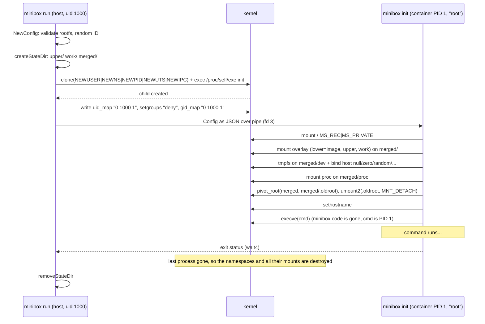

# Phase 1: Isolation

How `minibox run <rootfs> <cmd>` builds a container. Code lives in
`internal/container/`.

## The flow

| Step | File | Function |
|------|------|----------|
| Validate input, choose ID and state dir | `config.go` | `NewConfig`, `DefaultStateRoot` |
| Clone into namespaces, ID maps | `run.go` | `startInit`, `namespaces` |
| Pass config | `run.go` / `init.go` | `sendConfig` / `readConfig` |
| Filesystem setup | `fs.go` | `mountOverlay`, `setupDev`, `mountProc`, `pivotRoot` |
| Exec the command | `init.go` | `execCommand` |
| Signals, exit code | `run.go` | `forwardSignals`, `exitCode` |
| Cleanup | `state.go` | `removeStateDir` |

## Key decisions and why

**Re-exec (`/proc/self/exe init`).** Most container runtimes fork, set up
the child, then exec. Go can't run user code between fork and exec because
the runtime is multithreaded. So we start a second copy of minibox *inside*
the new namespaces and let it do the setup. runc does the same thing (with
a bit of C).

**User namespace first, so no root needed.** Creating mount/PID/UTS/IPC
namespaces normally needs `CAP_SYS_ADMIN`. When `CLONE_NEWUSER` is in the
same `clone`, the kernel creates the user namespace first, and we hold full
capabilities *inside it*. Those capabilities only apply to resources owned
by that user namespace (our new mounts and hostname), never to the host's.

**Single-ID mapping.** We map container UID 0 to our UID and nothing else.
An unprivileged process may only write that kind of map. Wider maps need
the setuid helper `newuidmap`. One consequence: `chown` to any other UID
fails inside the container. Alpine tools still work fine.

**`setgroups` deny.** The kernel refuses an unprivileged `gid_map` until
`/proc/<pid>/setgroups` is `deny`. Otherwise the container could drop a
supplementary group the host uses to *deny* access (for example a file with
mode `0705` owned by group `blocked`).

**overlayfs.** The image is the read-only lower layer, so it's never
modified and every container starts from the same clean state. Writes
copy the file up into the per-container `upper/`. Deletes leave a
"whiteout" there. Since kernel 5.11 this works inside a user namespace;
`/proc/mounts` shows the `userxattr` option, meaning overlay keeps its
metadata in `user.*` xattrs because it can't use `trusted.*`.

**`/dev` from bind mounts.** We can't `mknod` device nodes without
`CAP_MKNOD` in the *host* user namespace. So `/dev` is a fresh tmpfs, and
only harmless devices (null, zero, full, random, urandom, tty) are
bind-mounted in from the host. The container can't see disks or consoles.
Inside, they show as owned by `nobody` because host root isn't mapped.

**`pivot_root`, not `chroot`.** `chroot` only changes path lookup for one
process, and the old root stays mounted. A process with `CAP_SYS_CHROOT`
can escape with the classic "chroot into a subdir, then `cd ..` past it"
trick. `pivot_root` swaps the root *mount* of the whole mount namespace.
We then lazily unmount the old root, so the host filesystem is no longer
reachable from inside at all.

**`/proc` before `pivot_root`.** This was the one surprise. We first
mounted `/proc` after pivoting and got `EPERM`. The kernel only lets a user
namespace mount procfs if a fully visible procfs already exists in its
mount namespace (`mnt_already_visible()` in `fs/namespace.c`). Otherwise a
container could mount a fresh `/proc` to uncover paths the host had
deliberately over-mounted. After the old root is detached there's no such
procfs left, so we mount it while the host's is still visible.

**Config over a pipe.** Passing it in argv or the environment would leave
it visible in `/proc/1/cmdline` or `/proc/1/environ` until the exec, and
it would be inherited if we forgot to clear it. A pipe disappears once
read and closed.

**PID 1 and signals.** The kernel shields a PID namespace's init from any
signal it has no handler for. This applies even to SIGKILL sent from
inside the namespace. So `minibox run img sleep 100` ignores Ctrl-C, just
like `docker run` without `--init`. minibox forwards the first
SIGINT/SIGTERM/SIGHUP/SIGQUIT, which works for programs that handle it
(for example a shell with a `trap`). A second signal sends SIGKILL, which
the kernel always delivers when it comes from the parent namespace.
Zombie reaping is also the command's job, since it's PID 1. We'll revisit
this if a workload needs it.

**Cleanup.** We never call `umount` ourselves. The mounts exist only in
the container's mount namespace, and the kernel destroys that namespace
when its last process exits. The PID namespace guarantees that: when
PID 1 exits, every other process in it is killed. We only remove the state
directory, chmod-ing first because overlayfs leaves `work/work` as mode
000. `Pdeathsig=SIGKILL` kills the container if minibox itself dies.

**State on disk.** Container dirs go under
`~/.local/share/minibox/containers/<id>` (or `$MINIBOX_ROOT`), not
`/run/user/<uid>`. That's because `/run/user` is tmpfs, which is RAM, and
a container writing a big file would consume memory.

## Known limitations
- If minibox itself is SIGKILLed, the container is killed (Pdeathsig) but
  its state dir is left behind. It's safe to delete by hand.
- No `/sys` yet: mounting sysfs needs a network namespace owned by our
  user namespace (Phase 3).
- No `/dev/pts` and no new pseudo-terminal: the container shares the
  caller's terminal.
- The container shares the host's network (Phase 3) and has no resource
  limits (Phase 2).
