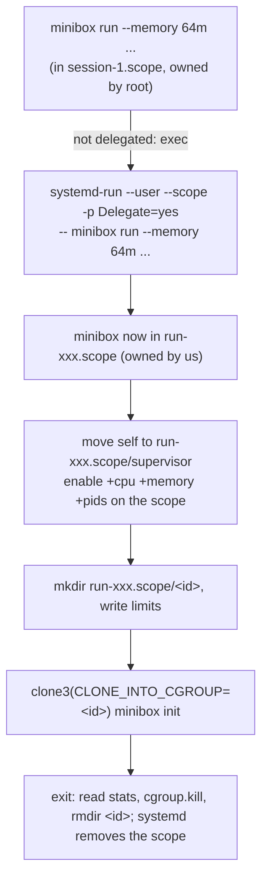

# Phase 2: Resource limits (cgroups v2)

Code: `internal/cgroups/` (limits, cgroup creation, stats) and the re-exec in
`cmd/minibox/run.go` (`reexecInScope`).

## Flags

| Flag | cgroup file | Meaning |
|------|-------------|---------|
| `--memory 64m` | `memory.max`, `memory.swap.max=0` | RAM cap; exceeding it gets the process OOM-killed |
| `--cpus 0.5` | `cpu.max` = `50000 100000` | At most 50 ms of CPU time per 100 ms period |
| `--pids 50` | `pids.max` | Max tasks (processes **and threads**); fork/clone fails beyond it |
| `--stats` | reads `cpu.stat`, `memory.peak`, `memory.events`, `pids.peak`, `pids.events` | Prints usage on exit |

## How a container gets its cgroup

## Key decisions and why

**Why re-exec under `systemd-run`.** Moving a process between cgroups needs
write access to the *common ancestor* of the old and new cgroup. A login
shell lives in `user-1000.slice/session-N.scope`, which is root-owned, so it
can't move anything into the user-owned `user@1000.service` subtree. A
transient scope with `Delegate=yes` is created by our per-user systemd and
`chown`ed to us. Rootless Podman does the same, but over D-Bus. We call the
`systemd-run` binary instead, so we need no extra Go dependency. We
`exec` it so the terminal, signals and exit code pass straight through.

**The `supervisor` leaf.** cgroup v2's "no internal processes" rule: a
cgroup that hands controllers to its children (`cgroup.subtree_control`) may
not contain processes itself. So minibox moves itself out of the scope root
first.

**`CLONE_INTO_CGROUP`.** The child is born inside its cgroup (clone3, Linux
5.7+, Go's `SysProcAttr.UseCgroupFD`). If we moved it in after `fork`
instead, a fast child could fork processes in that gap that escape the
limits.

**Swap off.** In cgroup v2, `memory.max` covers RAM only. This VM has 4 GB
of swap, so without `memory.swap.max=0` a memory hog would just swap instead
of being stopped.

**`--pids` minimum of 8.** `pids.max` counts threads. The container's first
task is `minibox init` (Go), whose runtime starts several threads before it
execs your command: 5 measured on this VM by default, 3-4 after we start init
with `GOMAXPROCS=1`. With `--pids 3` the Go runtime crashed, so we reject
values below 8 with an explanation.

**Cleanup.** After the container exits we read its stats, write
`cgroup.kill` (a safety net; the PID namespace already killed everything),
and `rmdir` the cgroup, retrying while the kernel finishes releasing the
last task (EBUSY). systemd removes the transient scope (`--collect`).

## Tests (`tests/smoke.sh`)
- 200 MiB `dd` buffer under `--memory 50m`: exit 137, `oom_kill=1`, `memory.peak` exactly 50 MiB.
- Bounded fork tree (about 380 tasks unlimited) under `--pids 20`: `pids.peak` = 20, refused forks reported.
- No cgroups left after exit.
- CPU throttling: written but **disabled by default** (`MINIBOX_TEST_CPU=1`). See the blocker below.

## Blocker: CPU limit tests on this VM
The `cpu.max` value is applied correctly, and the kernel does throttle
(`nr_throttled` rises). But on this VM a throttled busy loop sometimes ignores
SIGKILL for 10-60+ s. `scripts/repro-cpu-throttle.sh` reproduces this **without
minibox** (plain `systemd-run -p CPUQuota=25%`): 2 of 4 trials. Its
`usage_usec` also reported 27 s of CPU time for a 3 s run, which is impossible.

The guest kernel log explains it: repeated `soft lockup - CPU#N stuck for
27-84s`, RCU stalls and clocksource "Long readout interval" gaps of up to 60
s. The VirtualBox host is not running this VM's virtual CPUs for long
stretches. A throttled task that is not scheduled can't act on a pending
signal. `scripts/check-env.sh` now warns about this.
