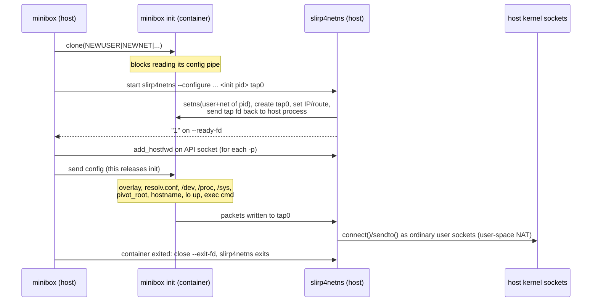

# Phase 3: Networking

Code: `internal/network/` (modes, port parsing, loopback, slirp4netns
wrapper), the `CLONE_NEWNET` flag and slirp start-up in
`internal/container/run.go`, and `/sys` plus `resolv.conf` in
`internal/container/fs.go`.

## Flags

| Flag | Meaning |
|------|---------|
| `--net none` *(default)* | New network namespace with only `lo` (UP). No route out. |
| `--net bridge` | Same, plus `tap0` = 10.0.3.100/24, gateway 10.0.3.2, DNS 10.0.3.3, outbound NAT via slirp4netns |
| `-p HOST:CONTAINER[/tcp\|udp]` | Forward a host port into the container (bridge only, repeatable, host port >= 1024) |

```sh
./bin/minibox run images/alpine ip addr                       # only lo
./bin/minibox run --net bridge images/alpine wget -qO- http://example.com
./bin/minibox run --net bridge -p 8080:80 images/alpine nc -l -p 80 -e echo hi
curl --http0.9 http://127.0.0.1:8080/                         # from the VM, prints "hi"
```

## How bridge mode works



Equivalent of what `--configure` does inside the namespace:

```sh
ip link set lo up
ip link set tap0 up mtu 65520
ip addr add 10.0.3.100/24 dev tap0
ip route add default via 10.0.3.2
```

## Key decisions and why

**slirp4netns, not veth + bridge + iptables.** The classic Docker setup is:
create a veth pair, move one end into the container, attach the other to a
Linux bridge (`docker0`) on the host, enable `net.ipv4.ip_forward`, and add an
iptables `MASQUERADE` rule for NAT. All of the host-side steps change the
**host's** network namespace, which needs `CAP_NET_ADMIN` in the initial user
namespace, i.e. real root:

| Step | Needs root? | Why |
|------|-------------|-----|
| `ip link add veth0 type veth peer name veth1` in host netns | yes | creating interfaces in the host netns |
| `ip link set veth1 netns <pid>` | yes | needs `CAP_NET_ADMIN` over **both** namespaces |
| `ip link add br0 type bridge; ip link set veth0 master br0` | yes | host netns |
| `sysctl net.ipv4.ip_forward=1` | yes | global kernel setting (it is 0 on this VM) |
| `iptables -t nat -A POSTROUTING -s 10.0.3.0/24 -j MASQUERADE` | yes | host firewall |
| inside container: `ip addr add`, `ip link set up` | no | our user namespace owns the container's netns |

minibox is rootless (and `sudo` would need a password on this VM), so it uses
**slirp4netns**, the same tool rootless Podman, Docker and Buildah use. It is a
user-mode TCP/IP stack (libslirp, originally from QEMU). Tradeoffs:

| | veth + bridge + NAT (root) | slirp4netns (rootless) |
|---|---|---|
| Privilege | root on the host | none |
| Data path | kernel only | every packet copied through a user-space process |
| Throughput / latency | best | lower (Phase 6 measures it); we use MTU 65520, as Podman does, to cut per-packet cost |
| Container-to-container | yes, via the bridge | no (each container has its own slirp) |
| Source IP seen by servers | container IP (if routed) or host IP (NAT) | always the host's IP |
| ICMP | full | ping only (needs `net.ipv4.ping_group_range`, set on this VM) |
| Attack surface | kernel netfilter/bridge code | slirp4netns process, which we sandbox |

We picked the simplest option that works without root. Phase 6 benchmarks
will measure what slirp costs. Other rootless options we didn't pick:
**pasta** (passt) is faster but isn't installed here, and **RootlessKit** with a
veth inside an extra namespace is more complex.

**Hardening slirp4netns itself.** It parses untrusted packets from the
container, so we start it with `--enable-sandbox` (it pivots into an empty
root) and `--enable-seccomp` (syscall filter), as Podman does. We also pass
`--disable-host-loopback`. Without it, the container could reach services
bound to the VM's `127.0.0.1` through the gateway address 10.0.3.2. Those
services usually assume only local users can reach them. A smoke test
checks this.

**No race between network and command.** init is created with
`CLONE_NEWNET`, so the namespace exists as soon as `clone` returns. init
then blocks reading its config pipe. minibox attaches slirp4netns, waits for
its `--ready-fd`, installs port forwards and only then sends the config. The
user's command can't start before `tap0` is configured, and we need no
extra synchronisation pipe.

**Cleanup that survives `kill -9`.** slirp4netns doesn't exit when the
container's namespace disappears (we tested this). We pass it the read end
of a pipe as `--exit-fd` and keep the write end. When minibox closes it,
or dies and the kernel closes it, slirp4netns exits. It runs in its own
process group so a Ctrl-C at the terminal goes to minibox (which forwards
it to the container) rather than killing the network early.

**Default is `--net=none`.** Docker defaults to bridge. We default to no
network because least privilege is the theme of the project: a container
gets network access only if it asks for it. It's also faster to start, with
no helper process.

**10.0.3.0/24, not slirp's default 10.0.2.0/24.** VirtualBox NAT gives the
VM itself 10.0.2.15 with gateway 10.0.2.2. It would work, since the container
has its own routing table, but showing the same addresses on both sides is
confusing in a demo.

**DNS.** The VM's `/etc/resolv.conf` points at systemd-resolved on
127.0.0.53, the host's loopback, which the container can't reach. In bridge
mode init writes `nameserver 10.0.3.3` (slirp's DNS forwarder) through the
overlay, so the image isn't changed.

**`/sys` now exists.** sysfs shows network devices for the mounting process's
network namespace, so the kernel only allows a user namespace to mount it if
it owns the current network namespace. With our own netns we can now mount
it (read-only). As with `/proc`, the mount has to happen before
`pivot_root`. This closes a Phase 1 open issue.

**Loopback via ioctl.** A new netns has `lo` DOWN. We bring it up with
`SIOCGIFFLAGS`/`SIOCSIFFLAGS` (`internal/network/loopback.go`). That's the old
interface `ifconfig` uses, chosen because it needs no netlink library.

## Tests (`tests/smoke.sh`, Phase 3 section)

- `--net=none`: only `lo` in `/sys/class/net`, `ping 127.0.0.1` works, no route
  out, `/sys` mounted read-only.
- bridge: `tap0` has 10.0.3.100/24, default route via 10.0.3.2, resolv.conf
  points at 10.0.3.3 and the image is untouched.
- Outbound NAT: fetch from a Python HTTP server on the VM's own address.
  This works without internet.
- Host loopback blocked: a server on the VM's `127.0.0.1` isn't reachable via
  10.0.3.2.
- `-p 18183:80`: a `nc` listener in the container answers a `curl` from the VM.
- DNS + internet (`example.com`). Skipped if the VM is offline.
- A busy host port is a clear error. No slirp4netns or state dirs are left
  behind. `-p` without bridge is rejected.
- Unit tests: `internal/network/config_test.go` (mode and port parsing),
  plus CLI flag errors in `cmd/minibox/main_test.go`.

## Known limitations

- Containers can't reach each other (no shared bridge).
- IPv4 only. slirp4netns's IPv6 support is experimental and not enabled.
- The host port must be >= 1024. Binding lower ports needs root (or lowering
  `net.ipv4.ip_unprivileged_port_start`).
- slirp4netns runs outside the container's cgroup, so its CPU and memory
  aren't charged to `--cpus`/`--memory`.
