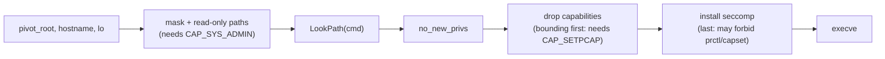

# Phase 4: Baseline security

Code: `internal/security/` (`caps.go`, `seccomp.go`, `docker.go`, `paths.go`,
`apply.go`), called from `internal/container/init.go`.

## What a container gets by default (`--security baseline`)

| Mechanism | What we do | Where |
|-----------|------------|-------|
| Capabilities | Keep only Docker's 14 defaults (CHOWN, DAC_OVERRIDE, FSETID, FOWNER, MKNOD, NET_RAW, SETGID, SETUID, SETFCAP, SETPCAP, NET_BIND_SERVICE, SYS_CHROOT, KILL, AUDIT_WRITE). Drop everything else, including SYS_ADMIN, SYS_PTRACE, NET_ADMIN and SYS_MODULE, from the bounding, effective, permitted and inheritable sets. Clear the ambient set. | `caps.go` |
| seccomp | Docker's default profile (`profiles/docker-default.json`, embedded and unmodified), compiled to BPF by our own code. Not allowed means `EPERM`. | `docker.go`, `seccomp.go` |
| Masked paths | `/dev/null` bind-mounted over files, empty read-only tmpfs over directories: `/proc/{acpi,asound,interrupts,kcore,keys,latency_stats,timer_list,timer_stats,sched_debug,scsi}`, `/sys/firmware`, `/sys/devices/virtual/powercap` | `paths.go` |
| Read-only paths | `/proc/{bus,fs,irq,sys,sysrq-trigger}` (bind onto itself, then remount read-only). All of `/sys` is already read-only since Phase 3. | `paths.go` |
| no_new_privs | `prctl(PR_SET_NO_NEW_PRIVS)`: setuid binaries and file capabilities can't grant anything at exec | `apply.go` |

`--security none` turns all of this off, leaving namespaces only. It's
the "no hardening" configuration for Phase 6. You can check the result
inside a container:

```sh
./bin/minibox run images/alpine grep -E '^(CapEff|CapBnd|NoNewPrivs|Seccomp)' /proc/self/status
# CapEff 00000000a80425fb (the same mask `docker run` shows), NoNewPrivs 1, Seccomp 2 (filter)
```

## Order of operations in init



All three of no_new_privs, capabilities and seccomp are **per-thread**, so
`Init` calls `runtime.LockOSThread()` first. The Go runtime could otherwise
move our goroutine to another OS thread between "drop caps" and "execve",
and we would exec from an unrestricted thread.

## Key decisions and why

**Why drop capabilities if we're already in a user namespace?** Container
root's capabilities only apply to objects its user namespace owns, so
`CAP_SYS_ADMIN` can't mount over the host's `/etc`. But it does let the
container mount filesystems, create more namespaces and use many other
kernel interfaces that are normally root-only. Each of those is kernel code
an attacker can reach, and bugs there have led to real escapes. The smoke
tests show that `--security none` allows `mount`, `unshare -U` and
`sethostname`, and the baseline blocks them.

**Why the bounding set matters.** When UID 0 runs `execve`, the kernel
grants it every capability in the bounding set. If we only cleared the
effective set, the next exec would give them all back. So we drop from the
bounding set (`PR_CAPBSET_DROP`) first. The smoke test checks `CapBnd` as
well as `CapEff`.

**Our own BPF compiler instead of libseccomp.** libseccomp-golang needs cgo
and the C library. Our compiler is about 200 lines (`seccomp.go`) and we can
explain every instruction it emits:

```
ld  arch;  jeq AUDIT_ARCH_X86_64 ? next : KILL   ; block 32-bit int 0x80 calls
ld  nr;    jge 0x40000000       ? DENY  : next   ; block the x32 ABI
jeq read   ? next : skip 1;  ret ALLOW           ; one block per syscall
jeq clone  ? next : skip 7;  ld args[0].hi ...   ; arg checks, then ALLOW or fall to DENY
...
ret ERRNO(EPERM)                                  ; default
```

Classic BPF loads 32 bits at a time, so a 64-bit argument comparison
checks the high and low halves separately (`compileArg`). Every jump stays
inside one syscall's block, so the 8-bit jump offsets never overflow. The
filter is a linear list, which is simpler but slower than libseccomp's
binary tree. Phase 6 measures the overhead.

**Testing the filter without installing it.** `seccomp_test.go` contains a
tiny BPF interpreter and runs the compiled program on hand-built
`seccomp_data` structs, for example "clone with CLONE_NEWUSER returns EPERM"
or "socket(AF_VSOCK) returns EPERM". Installing the filter in the test
process would restrict the test runner itself.

**Embedding Docker's JSON rather than copying its list.** Our baseline *is*
Docker's profile (pinned commit, checksum verified by
`scripts/get-docker-profile.sh`), interpreted with Docker's rules:
`includes.caps` entries apply only if we hold those capabilities,
`excludes.caps` entries don't apply if we do, and `arches` must match
`amd64`. So with the default caps, `mount`/`unshare`/`setns` stay denied
(they need SYS_ADMIN), and `chroot` is allowed (we keep SYS_CHROOT).
`clone` is allowed only without namespace flags (MASKED_EQ 0x7e020000 == 0).
`clone3` returns `ENOSYS`, because its flags sit in memory where seccomp
can't read them; libc then falls back to `clone`.

**Two places we're stricter than Docker.** We kill processes using the
32-bit x86 ABI and deny the x32 ABI, both of which Docker allows. minibox
targets x86_64 only, and these alternative syscall entry points are a
classic way to get around a filter.

**seccomp without TSYNC.** The filter only needs to be on the thread that
calls `execve`. Exec discards all other threads, and the new program
inherits that thread's filter. This matters in Phase 5: a strict allowlist
must not break Go runtime threads in the microseconds before exec.

**no_new_privs.** It's required to install a seccomp filter without
`CAP_SYS_ADMIN`. It also means a setuid-root binary inside the image can't
gain capabilities we dropped.

## Tests

- Unit tests (`internal/security/*_test.go`): the Docker baseline decisions
  above, 64-bit comparison edge cases, policy filters, Docker's
  default-caps mask `0xa80425fb`, and policy file validation.
- Smoke tests (Phase 4 section): CapEff/CapBnd/NoNewPrivs/Seccomp values;
  baseline blocks `mount`, `unshare`, `sethostname`, writes to `/proc/sys`
  and `/proc/sysrq-trigger`; `--security none` allows `mount`/`unshare`
  (control); `/sys/firmware` and `/proc/kcore` are masked; normal work
  still runs.

## Known limitations

- x86_64 only (syscall table and arch check).
- No `--cap-add`/`--cap-drop`. Phase 5's policy mode is how you get a
  different capability set.
- AppArmor/SELinux profiles aren't applied.
